# Verl 项目架构学习笔记

> 本文档沉淀自对 verl（HybridFlow）开源 RL 训练框架的源码学习与讨论。
> 重点放在**整体架构、Worker 初始化机制、HybridEngine 设计**等核心而易绕的部分，并尽量保留具体 GPU 使用示例帮助理解。
> 适用版本：verl main 分支（2026 年初）。

---

## 目录

- [一、项目定位与目录结构](#一项目定位与目录结构)
- [二、三个核心抽象（先理解这三层，全局就清晰了）](#二三个核心抽象先理解这三层全局就清晰了)
  - [2.2 `@register` 装饰器 + Dispatch 模式（深度解析）](#22-register-装饰器--dispatch-模式深度解析) ★
- [三、角色（Roles）与 HybridEngine 思想](#三角色roles与-hybridengine-思想)
- [四、入口流程：程序怎么跑起来](#四入口流程程序怎么跑起来)
- [五、Worker 初始化的五层抽象（最难也最精髓）](#五worker-初始化的五层抽象最难也最精髓)
- [六、`WorkerDict` 与 `ActorRolloutRefWorker` 的两层组合](#六workerdict-与-actorrolloutrefworker-的两层组合)
- [七、`spawn` 视图机制详解](#七spawn-视图机制详解)
- [八、`ActorRolloutRefWorker` 如何区分 actor/rollout/ref](#八actorrolloutrefworker-如何区分-actorrolloutref)
  - [8.5 三种子对象的调用路径对比（重要！）](#85-三种子对象的调用路径对比重要) ★
- [九、训练周边子系统（Reward / LLMServer / AgentLoop / CheckpointEngine）](#九训练周边子系统reward--llmserver--agentloop--checkpointengine)
  - [9.5 AgentLoopManager：异步 Rollout 编排层](#95-agentloopmanager异步-rollout-编排层) ★
- [十、数据准备层（Dataset / DataLoader / 普通 RL vs Agentic RL）](#十数据准备层dataset--dataloader--普通-rl-vs-agentic-rl) ★
- [十一、`fit()` 训练循环数据流](#十一fit-训练循环数据流)
- [十二、核心算法实现速览](#十二核心算法实现速览)
- [十三、典型调用栈与运行时调用追踪](#十三典型调用栈与运行时调用追踪)
- [十四、`main_ppo.py` vs `main_ppo_sync.py`：双训练入口对照](#十四main_ppopy-vs-main_ppo_syncpy双训练入口对照) ★
- [十五、学习路径与扩展方向](#十五学习路径与扩展方向)
- [十六、多机训练与分布式启动机制（Ray + PyTorch 协同）](#十六多机训练与分布式启动机制ray--pytorch-协同) ★
- [十七、`RayWorkerGroup` 内部细节与进程模型](#十七rayworkergroup-内部细节与进程模型) ★
- [十八、异步训练（one_step_off / fully_async）完整篇](#十八异步训练one_step_off--fully_async完整篇) ★

> 💡 verl 重度依赖 Ray 做调度，纯 Ray 的概念（placement group、bundle、actor 进程模型、调度策略等）单独沉淀在 [`ray_notes.md`](./ray_notes.md)，建议配合本文一起读。

> ★ 标记的子节是初读容易困惑、需要重点理解的部分。

---

## 一、项目定位与目录结构

### 1.1 定位

`verl`（Volcano Engine RL）是字节跳动 Seed 团队开源的 **HybridFlow 论文** 实现，面向 LLM 的 RL 训练库。

核心目标：
- **高效**：解决 RL 训练中"训练 (training)"与"推理生成 (rollout)"的资源调度难题
- **灵活**：通过 **Hybrid Controller** 编程模型让用户用十几行代码就能编排复杂 RL 数据流
- **解耦**：算法逻辑与分布式工程分离——算法工程师只关心训练循环，无需理解 FSDP/Megatron/vLLM 的具体细节

### 1.2 顶层目录结构

```
verl/
├── trainer/              # ★ 训练入口与训练循环编排
│   ├── main_ppo.py       #   主入口：Hydra 配置 + Ray 初始化
│   ├── ppo/
│   │   ├── ray_trainer.py   #   ★ 核心：RayPPOTrainer.fit() 训练循环
│   │   └── core_algos.py    #   ★ 所有 RL 算法的纯函数实现 (GAE/GRPO/PPO loss...)
│   └── config/           #   Hydra 默认配置文件
├── single_controller/    # ★ Hybrid Controller 抽象层（封装 Ray）
│   ├── base/
│   │   ├── worker.py        #   Worker 基类
│   │   ├── worker_group.py  #   WorkerGroup 抽象
│   │   └── decorator.py     #   ★ @register 装饰器 + Dispatch 模式
│   └── ray/base.py          #   RayWorkerGroup 实现
├── workers/              # ★ 真正在 GPU 上跑的角色
│   ├── engine_workers.py    #   ActorRolloutRefWorker / TrainingWorker
│   ├── engine/              #   训练后端：fsdp / megatron / torchtitan
│   ├── rollout/             #   推理后端：vllm / sglang / trtllm
│   └── reward_manager/      #   rule-based reward 计算
├── protocol.py           # ★ DataProto：跨 worker 的统一数据协议
├── experimental/         #   Agent Loop / Async Policy 等较新特性
└── utils/                #   fsdp/megatron/checkpoint/dataset 等工具
```

---

## 二、三个核心抽象（先理解这三层，全局就清晰了）

### 2.1 Single-Controller（单控制器）编程模型

整个训练由 **一个驱动进程（driver）** 调用 RPC 来编排，看起来像写单机代码：

```python
# 在 driver 上写起来就像普通 Python：
gen_output    = self.actor_rollout_wg.generate_sequences(batch)   # 远程 RPC
old_log_prob  = self.actor_rollout_wg.compute_log_prob(batch)     # 远程 RPC
values        = self.critic_wg.infer_batch(batch)                 # 远程 RPC
batch         = compute_advantage(batch, ...)                     # 在 driver 本地（轻量）
actor_output  = self.actor_rollout_wg.update_actor(batch)         # 远程 RPC
```

而每个 `*_wg`（WorkerGroup）背后是 **几十/几百个分布在不同 GPU 上的 Worker actor**，底层会自动完成数据切分（dispatch）→ 并行执行 → 结果聚合（collect）。

### 2.2 `@register` 装饰器 + Dispatch 模式（深度解析）

这套机制是 verl Single-Controller 编程模型的**灵魂**。算法工程师写起来：

```python
@register(dispatch_mode=make_nd_compute_dataproto_dispatch_fn(mesh_name="actor"))
def update_actor(self, data: TensorDict) -> TensorDict:
    output = self.actor.train_mini_batch(data=data)
    return output.cpu()
```

只用关心**业务逻辑 + 一个装饰器**；切分、Ray RPC、聚合、padding 这些分布式细节全部由框架接管。下面拆解它是怎么做到的。

#### 2.2.1 为什么需要这套机制

driver 调一次方法时，必须：
1. 把入参（如 `batch`）切成 N 份（按某种切法）
2. 同时发给 N 个 Worker 远程执行
3. 把 N 个返回值聚合回一个完整结果

不同方法切法不同：
- `init_model()`：不切，所有 Worker 干一样的事
- `compute_log_prob(batch)`：按 DP 切，结果 concat
- `update_weights(...)`：异步执行，driver 不等待

如果每写一个新方法都手写"切→发→等→聚"，会非常痛苦。`@register` + `Dispatch` 让这套逻辑**声明式化**。

#### 2.2.2 整体架构

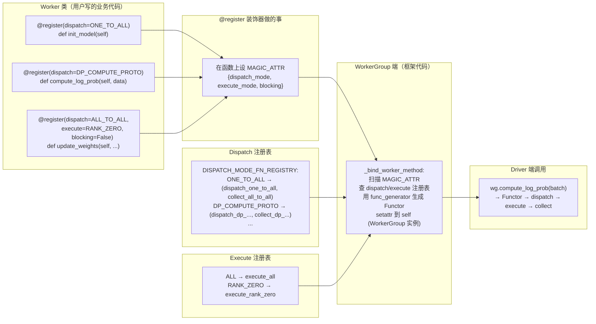

#### 2.2.3 `@register` 装饰器到底做了什么

核心代码（`decorator.py:398`）：

```python
def register(dispatch_mode=Dispatch.ALL_TO_ALL, execute_mode=Execute.ALL,
             blocking=True, materialize_futures=True):
    def decorator(func):
        @wraps(func)
        def inner(*args, **kwargs):
            if materialize_futures:
                args, kwargs = _materialize_futures(*args, **kwargs)   # 解 Future
            return func(*args, **kwargs)                                # 调原函数

        @wraps(func)
        async def async_inner(*args, **kwargs):                         # 异步函数版本
            if materialize_futures:
                args, kwargs = _materialize_futures(*args, **kwargs)
            return await func(*args, **kwargs)

        wrapper = async_inner if inspect.iscoroutinefunction(func) else inner

        # ★★★ 关键：把 dispatch/execute 配置以"标签"形式挂到函数上
        attrs = {"dispatch_mode": dispatch_mode, "execute_mode": execute_mode, "blocking": blocking}
        setattr(wrapper, MAGIC_ATTR, attrs)
        return wrapper
    return decorator
```

`MAGIC_ATTR = "attrs_3141562937"` —— 名字故意取得很怪，避免和用户属性冲突。

**装饰器只做了三件事**：
1. 包一层 `_materialize_futures`（解 `DataProtoFuture`）
2. **把 `dispatch_mode` / `execute_mode` / `blocking` 三个配置存到函数的 `MAGIC_ATTR` 属性上**
3. 返回包装后的函数

**关键认知：装饰器本身不做切分、不做 RPC**。它只是给函数贴了一个"标签"。真正的 dispatch/RPC 逻辑在 `WorkerGroup` 那一侧。

#### 2.2.4 Dispatch 模式速查表

每个 Dispatch 模式 = 一对函数 `(dispatch_fn, collect_fn)`，集中注册在 `DISPATCH_MODE_FN_REGISTRY` 里：

| 模式 | 切法 | 聚合 | 典型场景 |
|---|---|---|---|
| `ONE_TO_ALL` | 同一份广播给 N 个 | 返回 list[N] | `init_model()`, `set_loss_fn()` |
| `ALL_TO_ALL` | 原样透传 | 返回 list[N] | `_query_dispatch_info()` |
| `DP_COMPUTE` | 期待入参已是 list[N] | 返回 list[N] | 旧风格的 DP 切分 |
| `DP_COMPUTE_PROTO` | DataProto 按 N 切 + auto padding | concat 成完整 DataProto + 去 padding | **训练侧最常用** |
| `DP_COMPUTE_PROTO_WITH_FUNC` | 第一个参数广播，其它 DP 切 | concat | `execute_with_func_generator` |
| `DP_COMPUTE_METRIC` | 同 `DP_COMPUTE_PROTO` 切 | 不 concat（保留 list） | metric 收集 |
| `DIRECT_ROLLOUT_METHOD` | 报错（禁用 RPC） | 报错 | vLLM ExternalRayDistributedExecutor |
| 自定义 dict（`make_nd_compute_dataproto_dispatch_fn`） | 按 device mesh 的 dp_rank 切（lazy） | 按 collect_mask 过滤 + concat | **Megatron 3D 并行场景** |

#### 2.2.5 几种关键 Dispatch 详解

**(a) `ONE_TO_ALL`：广播**

```python
def dispatch_one_to_all(worker_group, *args, **kwargs):
    args = tuple([arg] * worker_group.world_size for arg in args)
    kwargs = {k: [v] * worker_group.world_size for k, v in kwargs.items()}
    return args, kwargs
```

每个 Worker 收到完全一样的参数。collect 不合并，返回 list[N]。

**(b) `DP_COMPUTE_PROTO`：DP 切分（最常用）**

把 `DataProto` 按 `world_size` 切 N 份，不能整除时**自动 padding**（很关键，避免业务代码处理 padding），padding 大小通过 `_padding_size_key` 记录在 kwargs 里，collect 时去除。

**(c) 自定义 nd-compute dispatch（Megatron 3D 并行）**

`DP_COMPUTE_PROTO` 假设 N 个 Worker 都参与 DP 切分（即 DP=N）。但 Megatron 用 TP × PP × DP 三维并行：
- 8 张 GPU + TP=2, PP=2 → DP=2
- 给数据时**只能切成 2 份**（不是 8 份），同 DP 组的 Worker 拿同一份

`make_nd_compute_dataproto_dispatch_fn(mesh_name)` 返回的不是 `Dispatch` 枚举，而是 dict：
- `dp_rank_mapping = [0, 0, 1, 1, 0, 0, 1, 1]` 记录每个全局 rank 属于哪个 DP rank
- `collect_mask = [True, False, ...]` 记录哪些 Worker 的输出要被收集（同 DP 组只收一个，避免重复）

**"lazy"** 体现在：第一次调用时才查 mesh 信息（每个 Worker 自己最清楚自己的 dp_rank），之后缓存。`mesh_name`（"actor"/"ref"/"critic"）作为缓存 key —— 因为同一个 Worker 在不同业务场景下可能属于不同的 DP 拓扑。

#### 2.2.6 Execute 模式：谁来执行

```python
Execute.register("ALL")          # 所有 Worker 都跑
Execute.register("RANK_ZERO")    # 只有 rank 0 跑
```

大部分方法用 `Execute.ALL`（默认）。`save_checkpoint` 等 driver-coordinated 的可以用 `Execute.RANK_ZERO`。

#### 2.2.7 `blocking` 参数：同步还是异步

- `blocking=True`（默认）：driver 调用后等结果回来再返回
- `blocking=False`：立即返回 `ray.ObjectRef`（Future），后续 `.get()` 取结果

实现处（`func_generator` 内）：
```python
output = execute_fn(method_name, *args, **kwargs)
if blocking:
    output = ray.get(output)        # ★ 这里看 blocking
```

#### 2.2.8 串起来：从函数定义到 driver 调用

以 `compute_log_prob` 为例：

**Step 1：定义阶段**（Worker 类被 import 时）

```python
class ActorRolloutRefWorker(Worker):
    @register(dispatch_mode=make_nd_compute_dataproto_dispatch_fn(mesh_name="actor"))
    def compute_log_prob(self, data):
        output = self.actor.infer_batch(data)
        return output.cpu()
```

`@register` 给 `compute_log_prob` 函数对象设 `attrs_3141562937 = {"dispatch_mode": {...}, "execute_mode": Execute.ALL, "blocking": True}`。此时函数还没和任何 RPC 逻辑关联。

**Step 2：扫描阶段**（`RayWorkerGroup.__init__` 时）

`_bind_worker_method` 扫描所有带 `MAGIC_ATTR` 的方法，根据标签查注册表，调 `func_generator` 生成 Functor，绑到 `WorkerGroup` 实例：

```python
for method_name in dir(user_defined_cls):
    method = getattr(user_defined_cls, method_name)
    if hasattr(method, MAGIC_ATTR):                        # ★ 只处理被装饰的
        attribute = getattr(method, MAGIC_ATTR)
        # 从 dispatch_mode 拿到 (dispatch_fn, collect_fn)
        # 从 execute_mode 拿到 execute_fn
        # 用 func_generator 生成 Driver 端 wrapper
        func = func_generator(self, method_name, dispatch_fn, collect_fn, execute_fn, blocking)
        setattr(self, method_name, func)                   # 绑到 WorkerGroup
```

**Step 3：调用阶段**（driver 调 `actor_rollout_wg.compute_log_prob(batch)`）

进入 Functor：

```python
class Functor:
    def __call__(this, *args, **kwargs):
        # 1️⃣ 切分
        args, kwargs = dispatch_fn(self, *args, **kwargs)
        padding_count = kwargs.pop(_padding_size_key, 0)
        # 2️⃣ 远程执行
        output = execute_fn(method_name, *args, **kwargs)
        # 3️⃣ 等待（如果 blocking）
        if blocking:
            output = ray.get(output)
        # 4️⃣ 聚合
        output = collect_fn(self, output)
        # 5️⃣ 去 padding
        if padding_count > 0:
            output = output.select_idxs([...:-padding_count])
        return output
```

**Step 4：到达 Worker 端**

Ray RPC 把方法调用送到 Worker 进程，进入 `@register` 生成的 `inner` wrapper：

```python
def inner(*args, **kwargs):
    if materialize_futures:
        args, kwargs = _materialize_futures(*args, **kwargs)
    return func(*args, **kwargs)        # 调真正的业务代码
```

最后业务代码 `output = self.actor.infer_batch(data)` 跑 FSDP 前向。

#### 2.2.9 完整运行时时序图

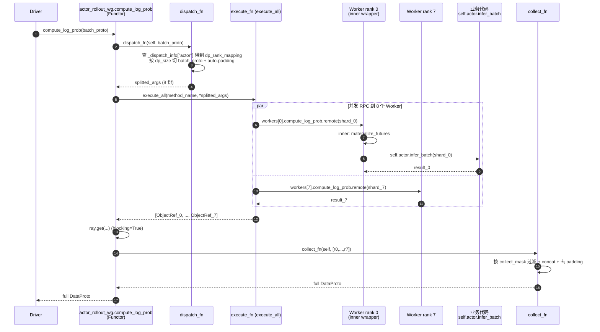

#### 2.2.10 关键设计精髓

**(a) `MAGIC_ATTR`：声明与实现的解耦**

业务代码只声明"我希望数据按 DP 切分"，不关心切法细节、Ray API、padding、concat。所有分布式逻辑由框架接管。

**(b) 注册表 + 装饰器：可扩展**

新加一种 dispatch 模式只需：

```python
register_dispatch_mode("PP_COMPUTE", my_dispatch, my_collect)
```

或自定义 dict：

```python
@register(dispatch_mode={"dispatch_fn": my_dispatch, "collect_fn": my_collect})
def my_method(self, data): ...
```

不需要改框架代码。

**(c) "白名单"机制**

`_bind_worker_method` 只扫描带 `MAGIC_ATTR` 的方法，**没装饰的方法不会暴露给 driver**。这避免内部辅助函数被误调。

**(d) Lazy 查询 + 缓存**

`dispatch_lazy_compute_data_proto` 第一次调用时才远程查 mesh 信息，之后缓存。避免大量预先元数据交换。

#### 2.2.11 易混淆点：为什么装饰器不直接把 dispatch 逻辑写进函数？

很多人初看会想：为什么不让装饰器直接产出一个"切→发→等→聚"的完整 wrapper，何必绕到 `WorkerGroup._bind_worker_method` + `Functor`？

**核心原因：`compute_log_prob` 这个方法在 Driver 和 Worker 两个进程都被 import，但执行身份完全不同**：

| 调用方 | 应该做什么 |
|---|---|
| **Driver 端** `wg.compute_log_prob(batch)` | dispatch → RPC → collect |
| **Worker 端**（Ray RPC 进来后） | 直接跑业务代码（FSDP forward） |

如果硬把 dispatch 逻辑塞进装饰器：
- Worker 进程里 `dispatch_fn(self, ...)` 没法跑 —— `self` 是 `ActorRolloutRefWorker` 不是 `WorkerGroup`，没有 `world_size` / `_workers` 等信息
- 装饰器在类定义时执行，那时 `WorkerGroup` 还不存在，没法把 `worker_group` 绑进闭包
- 同一个 Worker 类可能被绑到多个不同的 `WorkerGroup`（不同 world_size），装饰器写死会丧失灵活性
- Worker 内部互调时不应该走 dispatch（会无限递归）

**verl 的解法**：
- 装饰器只贴标签 + 生成 **Worker 端的 inner wrapper**（轻量，只解 Future + 调业务）
- `WorkerGroup.__init__` 时扫描标签，用 `func_generator` 动态生成 **Driver 端的 Functor**（含闭包绑 `worker_group`），绑到 `WorkerGroup` 实例上

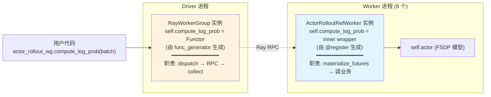

**同名方法、不同实现、分进程绑定** —— 类似 gRPC 中 client stub 和 server stub 由同一份 `.proto` 生成但实现完全不同的思路。

#### 2.2.12 一句话总结

> `@register` 装饰器只做一件事：**把 dispatch/execute 配置以"标签"形式贴到函数上**（`MAGIC_ATTR`）。
>
> `Dispatch` 模式是**预定义的"切发聚"策略库**，每个模式 = (dispatch_fn, collect_fn) 一对函数。`Execute` 模式控制**谁来执行**（全员 / 仅 rank 0）。
>
> 真正的分布式逻辑由 `WorkerGroup._bind_worker_method` 在初始化时扫描所有带标签的函数，根据标签查注册表，用 `func_generator` 生成 Functor 包装器，最终把 `wg.compute_log_prob` 变成一个会自动切分 → 远程并发执行 → 聚合的"魔法方法"。
>
> **算法工程师只写业务逻辑 + 一个装饰器；分布式细节、padding、Ray RPC、ND 切分全部由框架接管。** 这就是 verl Single-Controller 编程模型的精髓。

> 📌 **延伸**：`@register` 内部还偷偷套了一层 `tqbridge` 装饰器，让同一份业务方法可以同时承载 `DataProto` 和 `TransferQueue` 两种数据通路。详见 [第十四章 §14.5](#十四main_ppopy-vs-main_ppo_syncpy双训练入口对照)。

### 2.3 `DataProto` —— 统一数据协议

`verl/protocol.py` 的 `DataProto` 是 verl 中 **所有跨进程数据传输** 的载体：

- `batch`: `TensorDict`（结构化张量，如 `input_ids`、`responses`、`old_log_probs`、`advantages`）
- `non_tensor_batch`: 字典（如 `uid`、`raw_prompt`、`reward_extra_info`）
- `meta_info`: 元信息（如 `temperature`、`global_token_num`）

核心操作：`chunk()` 切分、`concat()` 拼接、`union()` 字段合并、`repeat()` 重复（用于 GRPO 的 group sampling）。

---

## 三、角色（Roles）与 HybridEngine 思想

### 3.1 Role 定义

`verl/trainer/ppo/utils.py`：

```python
class Role(Enum):
    Actor = 0              # 策略模型（要训练的）
    Rollout = 1            # 推理生成（vLLM/SGLang）
    ActorRollout = 2       # Actor + Rollout 混合（HybridEngine）
    Critic = 3             # 价值模型（仅 PPO/GAE 需要）
    RefPolicy = 4          # 参考模型（KL 约束用）
    RewardModel = 5        # 奖励模型（可选）
    ActorRolloutRef = 6    # Actor + Rollout + Ref 三合一
    Env = 7
    TeacherModel = 8       # 蒸馏教师模型
```

### 3.2 HybridEngine：verl 论文的核心贡献

**两个矛盾**：
1. **资源浪费**：如果给每种角色独占 GPU，rollout 时其它 GPU 闲置；训练时 rollout GPU 闲置
2. **代码复杂**：每种角色不同后端，分布式逻辑各不相同

**verl 的解法**：把 Actor、Rollout、Ref 放到 **同一组 GPU** 上，训练阶段做反向传播，推理阶段做生成。两者共享显存，通过 sleep/wakeup 切换 → 这就是论文标题 "HybridFlow" 的核心。

显存复用流程：
- **训练阶段**：`actor` 占大头（参数 + 梯度 + 优化器 + 激活）；`rollout` sleep 释放 KV cache；`ref` 通常 offload 到 CPU 或共享 actor 权重
- **Rollout 阶段**：`rollout`（vLLM）唤醒，加载权重 + 分配 KV cache；`actor` engine 释放激活（保留权重）
- **权重同步**：训练步结束后 `update_weights` 把 `self.actor` 的权重通过 `CheckpointEngine`（NCCL/Mooncake/NIXL）直接 GPU→GPU 推给 `self.rollout`，**不走 CPU、不写盘**

---

## 四、入口流程：程序怎么跑起来

```
shell run_xxx.sh
   └── python -m verl.trainer.main_ppo  config_overrides...
         └── @hydra.main → main(config)
               └── run_ppo(config)
                     ├── ray.init(...)                    # 启动 Ray 集群
                     ├── runner = TaskRunner.remote()     # 创建驱动进程的 Ray Actor
                     └── ray.get(runner.run.remote(config))
```

`TaskRunner.run()`（在 `main_ppo.py:219`）做四件事：

1. **注册角色 → Worker 类映射**（`role_worker_mapping`）：
   ```python
   self.role_worker_mapping[Role.ActorRolloutRef] = ray.remote(ActorRolloutRefWorker)
   self.role_worker_mapping[Role.Critic]          = ray.remote(TrainingWorker)
   ```

2. **资源池配置**：把每个角色映射到 GPU pool（默认所有角色共用 `global_pool`）

3. **创建数据集** (`create_rl_dataset`) 与 `RayPPOTrainer`

4. **`trainer.init_workers()` → `trainer.fit()`** 开始训练

> `init_workers()` 是后续 5~9 章的核心：先创建 Ray Actor + WorkerGroup（第 5~8 章），再建立 reward / llm_server / agent_loop / checkpoint 四个周边子系统（第 9 章）。数据准备层（dataset / dataloader）见第 10 章，`fit()` 训练循环见第 11 章。

---

## 五、Worker 初始化的五层抽象（最难也最精髓）

### 5.1 总览

verl 的 worker 初始化包了好几层，是因为要同时满足两个目标：
- **Colocate**：让多种角色共享同一组 GPU 进程（HybridEngine 前提）
- **Single Controller**：driver 上写起来像单机，dispatch 全自动

由内而外的五层：

```
最内层：Worker 实例（每张 GPU 上跑的真实 Python 对象）
   ↑
第二层：Ray Actor（被 ray.remote 包装后的 Worker，每个对应一张 GPU）
   ↑
第三层：WorkerDict（一个 Ray Actor 内承载多个独立 Worker 类）
   ↑
第四层：RayWorkerGroup（管理 N 个 Ray Actor，提供集合通信入口）
   ↑
第五层：spawn 出多个"视图" WorkerGroup（actor_rollout_wg / critic_wg）
   ↑
driver 看到的：self.actor_rollout_wg.compute_log_prob(batch)
```

### 5.2 各层职责表

| 层 | 类/函数 | 文件 | 作用 |
|---|---|---|---|
| 1 | `Worker` | `single_controller/base/worker.py` | 最底层抽象，从 env vars 读 rank/world_size |
| 1 | `ActorRolloutRefWorker` | `workers/engine_workers.py` | 业务 Worker，含 actor/rollout/ref 三个子对象 |
| 2 | `ray.remote(cls)` | Ray API | 把普通类变成 Ray Actor 类 |
| 2 | `RayClassWithInitArgs` | `single_controller/ray/base.py:336` | 包装 cls + 构造参数，**延迟实例化** |
| 3 | `create_colocated_worker_cls` | `single_controller/ray/base.py:986` | **动态生成 `WorkerDict` 类**，让一个 Ray Actor 承载多个 worker |
| 3 | `WorkerDict` | 动态创建 | 内部 `worker_dict = {role: worker}`；方法名加 prefix |
| 3 | `_bind_workers_method_to_parent` | `single_controller/ray/base.py:918` | 把内部 worker 的 `@register` 方法 monkey-patch 到 `WorkerDict` |
| 4 | `RayWorkerGroup` | `single_controller/ray/base.py:416` | 管理 N 个 Ray Actor，处理 placement group、env_vars 注入 |
| 4 | `_bind_worker_method` | `single_controller/base/worker_group.py:185` | 扫描 `@register` 方法，生成 dispatch/collect wrapper |
| 4 | `func_generator` | `single_controller/ray/base.py:48` | 生成 Functor：dispatch → execute → collect |
| 5 | `spawn` | `single_controller/ray/base.py:716` | 共享底层 Actor，按前缀拆出多个视图 WorkerGroup |
| 5 | `_rebind_actor_methods` | 同上 | 去掉方法前缀（`critic_train_mini_batch` → `train_mini_batch`） |

### 5.3 Layer 1：`Worker`（最底层 Python 对象）

每张 GPU 上跑一个真实 Python 进程，进程里有一个 `Worker` 实例：

```python
class Worker(WorkerHelper):
    def __init__(self, cuda_visible_devices=None) -> None:
        # 从环境变量读分布式信息
        world_size  = int(os.environ["WORLD_SIZE"])
        rank        = int(os.environ["RANK"])
        master_addr = os.environ["MASTER_ADDR"]
        master_port = os.environ["MASTER_PORT"]
```

**关键设计**：所有分布式信息（rank、world_size、master_addr）都通过环境变量传递（PyTorch DDP 的标准做法）。`RayWorkerGroup` 在创建 Ray Actor 时通过 `runtime_env.env_vars` 注入。

### 5.4 Layer 2：`ray.remote(Worker)` + `RayClassWithInitArgs`

```python
self.role_worker_mapping[role] = ray.remote(actor_rollout_cls)
```

`ray.remote(...)` 把普通 Python 类变成 Ray 的 "Actor 类"。本身还不是实例，只是一个"等待被远程调用 `.remote()` 来创建实例"的东西。

`RayClassWithInitArgs(cls, *args, **kwargs)` 包装 cls + 构造参数，**延迟实例化**——让 placement group 创建与 worker 实例化解耦。

### 5.5 Layer 3：`WorkerDict` —— 关键的 colocate 技巧

**核心代码**（`single_controller/ray/base.py:986`）：

```python
def create_colocated_worker_cls(class_dict):
    # class_dict = {"actor_rollout_ref": ActorRolloutRefCls, "critic": CriticCls}
    
    class WorkerDict(worker_cls):              # 动态创建一个新类
        def __init__(self):
            super().__init__()
            self.worker_dict = {}
            for key, user_defined_cls in cls_dict.items():
                with temp_env_var("DISABLE_WORKER_INIT", "1"):
                    # 在自己内部实例化每个原始 worker 类
                    self.worker_dict[key] = user_defined_cls(*args, **kwargs)
    
    # 把每个内部 worker 的方法"monkey-patch" 到 WorkerDict 上
    # 方法名加前缀，例如 actor_rollout_ref.compute_log_prob → actor_rollout_ref_compute_log_prob
    for key, user_defined_cls in cls_dict.items():
        _bind_workers_method_to_parent(WorkerDict, key, user_defined_cls)
    
    remote_cls = ray.remote(WorkerDict)
    return RayClassWithInitArgs(cls=remote_cls)
```

**关键点**：
1. `WorkerDict` 内部维护字典 `self.worker_dict = {"actor_rollout_ref": ARR_obj, "critic": Critic_obj}`
2. `WorkerDict` 上**不存在** `compute_log_prob`，但**存在** `actor_rollout_ref_compute_log_prob`，实现就是 `return self.worker_dict["actor_rollout_ref"].compute_log_prob(...)`
3. Ray 把 `WorkerDict` 实例化为一个 Ray Actor，这个 Actor 既能调 actor_rollout_ref 的方法，又能调 critic 的方法

为什么要加前缀？防止两个独立 Worker 类有同名方法（比如都有 `save_checkpoint`）时冲突。

### 5.6 Layer 4：`RayWorkerGroup` —— 管理一组 Ray Actor

`RayWorkerGroup.__init__()` 做的事情（简化）：

```python
# 1) 拿到 placement group（Ray 的 GPU 占位机制）
pgs = resource_pool.get_placement_groups(strategy="STRICT_PACK")

# 2) 为每个 GPU 创建一个 Ray Actor
for pg_idx, pg in enumerate(pgs):
    for local_rank in range(local_world_size):
        rank += 1
        env_vars = {
            "WORLD_SIZE": str(world_size), "RANK": str(rank),
            "MASTER_ADDR": self._master_addr, "MASTER_PORT": self._master_port,
            ...
        }
        ray_cls_with_init.update_options({"runtime_env": {"env_vars": env_vars}})
        worker = ray_cls_with_init(placement_group=pg, ...)   # 创建 Ray Actor
        self._workers.append(worker)

# 3) 扫描 WorkerDict，把所有 @register 方法绑到 self
self._bind_worker_method(self.ray_cls_with_init.cls, func_generator)
```

`func_generator`（`ray/base.py:48`）是 driver 端 RPC 的核心包装：

```python
def func_generator(self, method_name, dispatch_fn, collect_fn, execute_fn, blocking):
    class Functor:
        def __call__(this, *args, **kwargs):
            args, kwargs = dispatch_fn(self, *args, **kwargs)   # ① 切分数据
            output = execute_fn(method_name, *args, **kwargs)   # ② 远程调用所有 worker
            if blocking:
                output = ray.get(output)                        # ③ 等待结果
            output = collect_fn(self, output)                   # ④ 聚合
            return output
    return type(method_name, (Functor,), {})()
```

至此，driver 上调 `wg_dict.actor_rollout_ref_compute_log_prob(batch)` 会自动完成：切分 → 给所有 Worker 同时跑 → 等待 → 聚合。

### 5.7 完整初始化流程（mermaid）

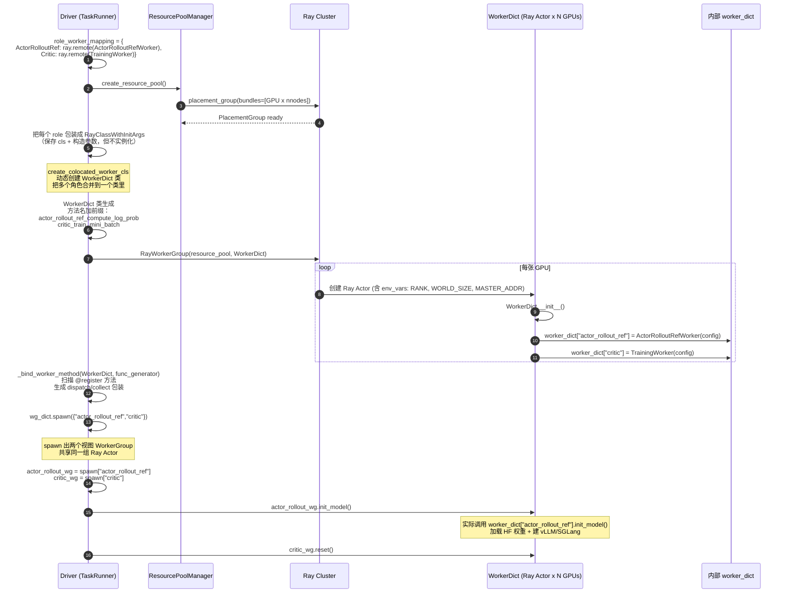

---

## 六、`WorkerDict` 与 `ActorRolloutRefWorker` 的两层组合

这是初学时极易混淆的地方：`ActorRolloutRefWorker` 本身已经包含 actor/rollout/ref 三个子对象了，那 `WorkerDict` 还有什么用？

### 6.1 答案：两个不同层级的组合

| 层级 | 谁来组合 | 组合什么 | 解决的问题 |
|---|---|---|---|
| **业务层组合** | `ActorRolloutRefWorker`（业务代码） | actor / ref / rollout 三个**业务子组件** | HybridEngine：让同一份模型权重同时支持训练 + 推理 |
| **框架层组合** | `WorkerDict`（框架自动生成） | `ActorRolloutRefWorker` + `TrainingWorker(critic)` 两个**完全独立的 Worker 类** | 让逻辑上不同的 WorkerGroup 物理上落在同一组 GPU 上 |

### 6.2 具体 GPU 例子：8 张 GPU 跑 PPO

#### ❌ 朴素做法（没有 WorkerDict）

```python
actor_rollout_wg = RayWorkerGroup(pool_A, ActorRolloutRefWorker)  # 占 8 张 GPU
critic_wg        = RayWorkerGroup(pool_B, TrainingWorker)         # 又占 8 张 GPU
# 总共要 16 张 GPU！
```

或者两组 worker 用同一个 placement group，但仍然是 **16 个独立的 Python 进程**，每个进程占一张 GPU 的一部分（各占 0.5 张）—— 两个进程都要持有自己的模型副本，**显存爆炸**。

#### ✅ verl 的做法（有 WorkerDict）

```python
# 8 张 GPU，每张 GPU 上跑一个 WorkerDict 进程
# 这个 WorkerDict 进程内部同时持有：
#   self.worker_dict["actor_rollout_ref"] = ActorRolloutRefWorker(...)
#   self.worker_dict["critic"]            = TrainingWorker(...)
# 所以 actor + critic 共享同一张 GPU 的同一个进程！
```

### 6.3 为什么不把 critic 也写进 ActorRolloutRefWorker？

三个理由：

1. **colocate 关系不是固定的**：
   - GRPO 不要 critic（用 group baseline）
   - 大 critic 可能要独立 GPU 池
   - 加 reward model 是否 colocate 用户决定
   
   硬编码进 `ActorRolloutRefWorker` 会写死 colocate 关系。

2. **actor/ref/rollout 共享权重，critic 不共享**：
   - actor/ref/rollout 是**同一个 LLM 的三种用法**（训练态、冻结态、推理态），权重相同 → HybridEngine 显存复用
   - critic 是**完全不同的模型**（LLM + value head），权重独立、参数量不同

3. **扩展性**：加 teacher、reward model 等新角色，只需在 `init_workers` 加一行 `class_dict["teacher"] = ...`，`WorkerDict` 自动 colocate

### 6.4 两层组合的清晰对比图

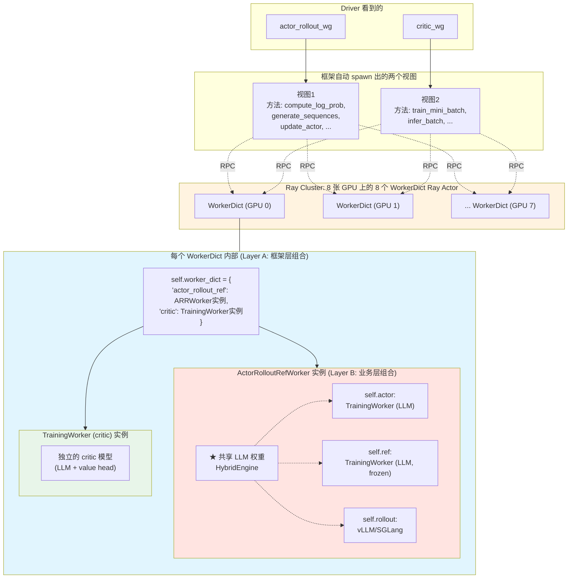

### 6.5 不同配置下的 `class_dict` 形态

```python
# GRPO（不要 critic）
class_dict = {"actor_rollout_ref": ActorRolloutRefWorker}

# PPO 标准（colocate）
class_dict = {
    "actor_rollout_ref": ActorRolloutRefWorker,
    "critic":            TrainingWorker,
}

# PPO + 独立 RM（colocate）
class_dict = {
    "actor_rollout_ref": ActorRolloutRefWorker,
    "critic":            TrainingWorker,
    "rm":                RewardModelWorker,
}

# PPO + critic 独占 GPU pool（不 colocate）
# 此时是两个不同的 resource_pool，对应两个独立 RayWorkerGroup
```

### 6.6 一句话总结

> `ActorRolloutRefWorker` 内部的"actor / ref / rollout 三对象"是**业务层组合**（同一个 LLM 的三种用法，共享权重）；
>
> `WorkerDict` 是**框架层组合**（让多个**互相独立、互不感知**的 Worker 类共享同一张 GPU 的同一个 Ray Actor 进程）。
>
> 两者解决的问题完全不同，互不替代。

---

## 七、`spawn` 视图机制详解

### 7.1 先把"几个数"钉死

假设 **8 张 GPU + PPO（actor_rollout_ref + critic）**：

| 名字 | 是什么 | 多少个 | 在哪里 |
|---|---|---|---|
| `RayWorkerGroup` 实例 | Driver 端的 Python 对象，管理一组 Ray Actor | **1** 个（叫 `wg_dict`） | Driver 进程内存里 |
| Ray Actor | GPU 上跑的远程进程 | **8** 个（每张 GPU 一个） | 8 张 GPU |
| Ray Actor 内部的 `WorkerDict` 实例 | Ray Actor 进程里的 Python 对象 | **8** 个（每个 Ray Actor 内部 1 个） | 8 张 GPU 各自进程里 |
| spawn 出来的视图 WorkerGroup | Driver 端的 Python 对象（视图） | **2** 个（`actor_rollout_wg`、`critic_wg`） | Driver 进程内存里 |

关键澄清：
- "wg_dict 只有一个" 指的是 **Driver 端的 Python 对象只有一个 `RayWorkerGroup` 实例**
- "里面 N 个 Ray Actor" 指的是 **这个 `RayWorkerGroup` 实例的 `self._workers` 列表里有 N 个 Ray Actor handle**

### 7.2 `init_workers` 里到底创建了几个东西

```python
for resource_pool, class_dict in self.resource_pool_to_cls.items():
    # class_dict = {"actor_rollout_ref": ARRcls, "critic": Critic_cls}

    # ① 生成 WorkerDict 类（Python 类，不是实例）
    worker_dict_cls = create_colocated_worker_cls(class_dict=class_dict)

    # ② 创建 RayWorkerGroup 实例 —— 只有一个！
    wg_dict = self.ray_worker_group_cls(
        resource_pool=resource_pool,
        ray_cls_with_init=worker_dict_cls,
    )
    # ↑ 构造函数内部循环 8 次，创建 8 个 Ray Actor，存到 wg_dict._workers 列表

    # ③ 从这一个 RayWorkerGroup 派生出多个视图
    spawn_wg = wg_dict.spawn(prefix_set=class_dict.keys())
    # spawn_wg = {
    #     "actor_rollout_ref": <RayWorkerGroup 视图1>,
    #     "critic":            <RayWorkerGroup 视图2>,
    # }
```

### 7.3 为什么需要 spawn？方法名前缀问题

`wg_dict` 上**不存在** `compute_log_prob`，因为 `_bind_worker_method` 扫描的是 `WorkerDict`，方法是**加了前缀的**：

```python
wg_dict.actor_rollout_ref_compute_log_prob(batch)   # ✓ 能调
wg_dict.actor_rollout_ref_update_actor(batch)       # ✓ 能调
wg_dict.critic_train_mini_batch(batch)              # ✓ 能调
wg_dict.compute_log_prob(batch)                     # ✗ AttributeError
```

但 driver 希望优雅写法：

```python
self.actor_rollout_wg.compute_log_prob(batch)
self.critic_wg.train_mini_batch(batch)
```

`spawn` 就是把方法名"去前缀"。

### 7.4 `spawn` 源码精讲

```python
def spawn(self, prefix_set):
    # prefix_set = {"actor_rollout_ref", "critic"}
    new_worker_group_dict = {}
    for prefix in prefix_set:
        # ① 创建一个新的 RayWorkerGroup Python 对象（仅 driver 端）
        new_worker_group = self.from_detached(
            worker_names=self._worker_names,
            worker_handles=self._workers,        # ★ 复用同一组 Ray Actor handle
            ray_cls_with_init=self.ray_cls_with_init,
        )

        # ② 把带前缀的方法重命名（去前缀）
        _rebind_actor_methods(new_worker_group, prefix)

        new_worker_group_dict[prefix] = new_worker_group
    return new_worker_group_dict


def _rebind_actor_methods(worker_group, actor_name):
    prefix = actor_name + "_"
    for method_name in dir(worker_group):
        if method_name.startswith(prefix):
            original_method_name = method_name.removeprefix(prefix)
            method = getattr(worker_group, method_name)
            setattr(worker_group, original_method_name, method)
```

### 7.5 视图本质：Python 对象引用 vs Ray Actor handle 引用

这里要区分两种"引用"：

| 维度 | 是不是新的 |
|---|---|
| 视图 `actor_rollout_wg` 本身（Python 对象） | **是新的**（`from_detached` 调了 `cls(...)` 重新构造） |
| 视图的 `self._workers` 列表 | 引用同一个 list |
| 列表里的每个 Ray Actor handle | **完全共享**（同一个 `ray.actor.ActorHandle` 对象） |
| handle 指向的远程 Ray Actor 进程 | **同一个进程**（GPU 上的物理进程） |
| 视图上的方法（Functor） | **新的**（rebind 重新 setattr 到视图实例上） |

### 7.6 内存视角图

```
Driver 进程内存:

  wg_dict ──────────► RayWorkerGroup 实例 A (id=0x100)
                       ├─ self._workers ──► list_X
                       │                     ├─ ActorHandle 0 (id=0x300) ──► [Ray Actor on GPU 0]
                       │                     ├─ ActorHandle 1 (id=0x301) ──► [Ray Actor on GPU 1]
                       │                     ├─ ...
                       │                     └─ ActorHandle 7 (id=0x307) ──► [Ray Actor on GPU 7]
                       └─ 方法集:
                           actor_rollout_ref_compute_log_prob → Functor_a
                           critic_train_mini_batch            → Functor_b

  actor_rollout_wg ──► RayWorkerGroup 实例 B (id=0x101) ← 新的 Python 对象!
                       ├─ self._workers ──► list_Y
                       │                     ├─ ActorHandle 0 (id=0x300) ← 同一个 handle!
                       │                     ├─ ...
                       │                     └─ ActorHandle 7 (id=0x307)
                       └─ 方法集:
                           compute_log_prob                   → 同一个 Functor_a (rebind 后)
                           actor_rollout_ref_compute_log_prob → 同一个 Functor_a (旧名)
                           critic_train_mini_batch            → 同一个 Functor_b
                           ...

  critic_wg ────────► RayWorkerGroup 实例 C (id=0x102) ← 又一个新 Python 对象
                       ├─ self._workers ──► list_Z
                       │                     └─ 同样 8 个 ActorHandle (0x300~0x307)
                       └─ 方法集:
                           train_mini_batch                   → 同一个 Functor_b (rebind 后)
```

要点：
- 三个 `RayWorkerGroup` 实例是 **三个不同的 Python 对象**
- 但它们的 `_workers` 列表里装的是 **完全相同的 8 个 `ActorHandle` 对象**
- `ActorHandle` 是 Ray 的"远程对象引用"，本质上是网络句柄

### 7.7 视图共享底层 Ray Actor

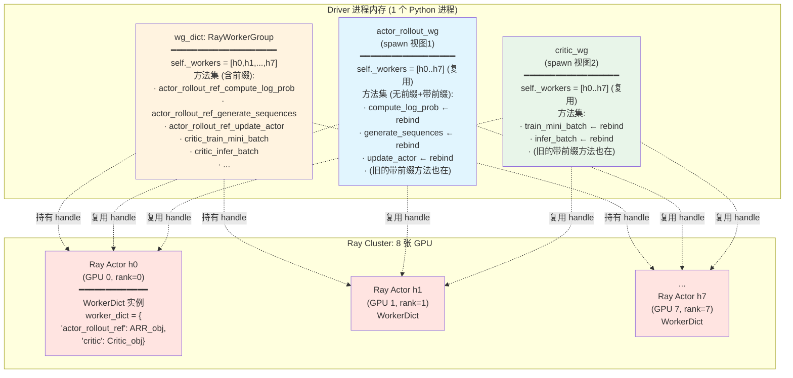

### 7.8 关键认知：spawn 是纯 Driver 端操作

- 它不发任何 RPC
- 它不创建新进程
- 它不修改 Ray Actor 内部状态
- 它只是在 Driver 内存里 new 几个 `RayWorkerGroup` 实例，让它们的 `_workers` 字段指向同一组 handle，然后做 setattr 改方法名

GPU 上的 Ray Actor 完全不知道自己被几个视图"引用"着。

### 7.9 类比：快捷方式 / SQL View

可以这样理解：
- `wg_dict` 是真实的"文件夹"，里面有所有方法（带前缀）
- `actor_rollout_wg` 和 `critic_wg` 是 **桌面上的两个快捷方式**
- 双击快捷方式 = 打开同一个文件夹，只显示自己关心的那部分文件
- 真正的数据（Ray Actor 进程）只有一份

或用 SQL 类比：
- `wg_dict` 是基础表（含所有列）
- `actor_rollout_wg` 是 `CREATE VIEW actor_rollout_wg AS SELECT compute_log_prob, ... FROM wg_dict`
- `critic_wg` 是 `CREATE VIEW critic_wg AS SELECT train_mini_batch, ... FROM wg_dict`

### 7.10 关于"跨进程地址共享"的精确说法

跨进程没有"共享地址"这一说（不同进程内存隔离），跨进程的"共享"通过 Ray 的 `ActorHandle` + RPC 实现：

| 对象 | 实例数量 | 地址在哪个进程 |
|---|---|---|
| `RayWorkerGroup`（视图） | 3 个 | Driver 进程的内存地址 |
| `ActorHandle` | 8 个（每个视图复用同一组） | Driver 进程的内存（handle 本身），但**指向** GPU 进程 |
| `WorkerDict` Python 实例 | 8 个（每张 GPU 1 个） | 8 个 Ray Actor 进程各自的内存 |
| `ActorRolloutRefWorker` Python 实例 | 8 个（每张 GPU 1 个） | 同上，在 `WorkerDict.worker_dict["actor_rollout_ref"]` |
| `TrainingWorker (critic)` Python 实例 | 8 个 | 同上，在 `WorkerDict.worker_dict["critic"]` |

### 7.11 一句话总结

> `wg_dict` 是 **唯一的物理管理者**（一个 Python 对象，持有 N 个 Ray Actor handle 和所有带前缀的方法）；
>
> `spawn` 出来的 `actor_rollout_wg` / `critic_wg` 是 **逻辑上的视图**（多个 Python 对象，复用同一组 Ray Actor handle，但通过 rebind 把方法名去掉前缀，让 driver 写代码时干净优雅）；
>
> Ray Actor（GPU 进程）始终只有 N 个，没有因为 spawn 而增加。

---

## 八、`ActorRolloutRefWorker` 如何区分 actor/rollout/ref

`role` 用字符串包含关系决定本 Worker 要承担哪些子身份：

### 8.1 三个独立的子对象

```python
class ActorRolloutRefWorker(Worker, DistProfilerExtension):
    def __init__(self, config, role: str, ...):
        self.role = role                                    # "actor_rollout_ref"
        self.actor: TrainingWorker = None                   # 待 init
        self.ref: TrainingWorker = None                     # 待 init
        self.rollout: BaseRollout = None                    # 待 init

        # role 字符串解析出三个布尔标志
        self._is_actor   = self.role in ["actor", "actor_rollout", "actor_rollout_ref"]
        self._is_rollout = self.role in ["rollout", "actor_rollout", "actor_rollout_ref"]
        self._is_ref     = self.role in ["ref", "actor_rollout_ref"]
```

### 8.2 `init_model()` 按需构造

```python
@register(dispatch_mode=Dispatch.ONE_TO_ALL)
def init_model(self):
    # 1. 构造 ref（TrainingWorker，跑 FSDP/Megatron 前向）
    if "ref" in self.role:
        self.ref = TrainingWorker(config=ref_training_config)
        ...

    # 2. 构造 actor（同样 TrainingWorker，但有 optimizer，要做反向）
    if "actor" in self.role:
        self.actor = TrainingWorker(config=actor_training_config)
        ...

    # 3. 构造 rollout（vLLM/SGLang）
    if "rollout" in self.role:
        self.rollout = get_rollout_class("vllm", "async")(...)
```

注意：actor 和 ref 都是 `TrainingWorker`，但**配置不同**（ref 不需要 optimizer、不需要梯度）。

### 8.3 方法路由表

| Driver 调的方法 | 内部子对象 | 干什么 |
|---|---|---|
| `compute_log_prob` | `self.actor` | actor 模型前向（不更新） |
| `compute_ref_log_prob` | `self.ref` | ref 模型前向 |
| `update_actor` | `self.actor` | actor 模型 backward + step |
| `generate_sequences` | `self.rollout` | vLLM/SGLang 推理生成 |
| `update_weights` | `self.actor → self.rollout` | actor 权重同步给 rollout |

### 8.4 流程图：内部三身份切换

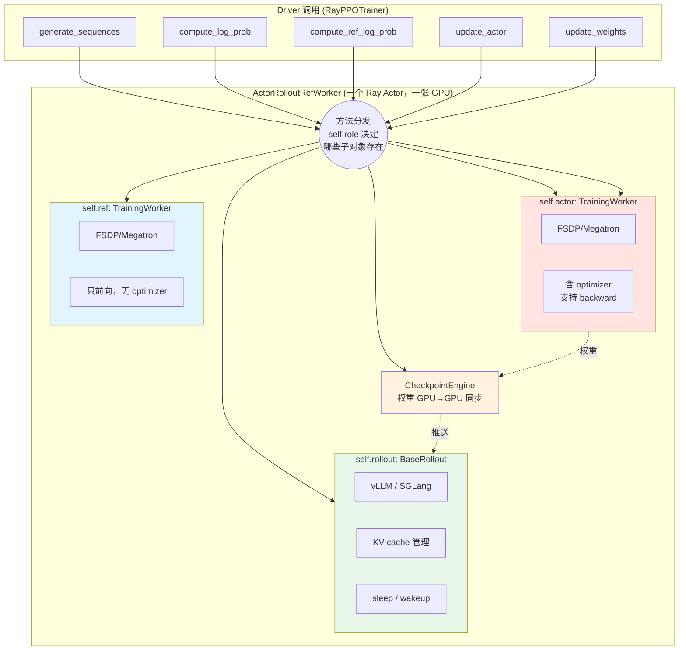

### 8.5 三种子对象的调用路径对比（重要！）

虽然 actor / ref / rollout 都是 `ActorRolloutRefWorker` 的子对象，但 driver 调用它们时**走的不是同一条路径**：

> ⚠️ **重要纠偏**（2026/05 更新）：早期文档（包括本节先前版本）把 rollout 路径描述为"走 HTTP"，这是**精度不够的表达**。
>
> **实际情况**：verl **内部** rollout 调用走的也是 **Ray RPC**（`server.generate.remote(...)`），**只是绕了一层 server actor**。vLLM/SGLang 进程内确实启动了一个 FastAPI/uvicorn HTTP server，但它的服务对象是**外部客户端**（OpenAI SDK、Prometheus、验证脚本），**不被 verl 训练循环使用**。详见 §8.5.4。

#### 8.5.1 路径对比表

| 子对象 | Driver 入口 | 调用路径 | 通信方式 |
|---|---|---|---|
| `self.actor` | `actor_rollout_wg.compute_log_prob` / `.update_actor` | Driver → Ray RPC（DP_COMPUTE_PROTO dispatch）→ `ActorRolloutRefWorker.compute_log_prob/update_actor` → `self.actor.infer_batch/train_mini_batch` | **Ray RPC（直接派发到 actor_rollout_wg 的 16 个 worker）** |
| `self.ref` | `ref_policy_wg.compute_ref_log_prob` | Driver → Ray RPC → `ActorRolloutRefWorker.compute_ref_log_prob` → `self.ref.infer_batch` | **Ray RPC（同上，复用同一组 worker）** |
| `self.rollout` | `async_rollout_manager.generate_sequences` | Driver → `AgentLoopManager`(actor) → `AgentLoopWorker`(actor) → `SingleTurnAgentLoop.run` → `LLMServerClient.generate` → `GlobalRequestLoadBalancer.acquire_server.remote()` → 拿到 `vLLMHttpServer` actor handle → `server.generate.remote(...)` | **Ray RPC（绕一层 server actor + 负载均衡）** |

**两条 Ray RPC 路径的本质差异**：

| 维度 | actor / ref 路径 | rollout 路径 |
|---|---|---|
| 派发模型 | SPMD：driver 一次调用 → 16 个 worker 并行跑同一个方法 | 异步样本级：driver 调一次 → 切到 N 个 AgentLoopWorker → 每个 worker 用 asyncio 跑 M 条样本 |
| dispatch 机制 | `@register(dispatch_mode=...)` 自动 chunk + collect | 手写 `prompts.chunk(...)` + `asyncio.gather` |
| 目标 actor | `actor_rollout_wg._workers`（GPU worker） | `vLLMHttpServer` actor（持有 vLLM engine） |
| 并发粒度 | DP 切分粒度 | 每条 prompt 一个 asyncio task |
| 是否 in-process | 是（actor / rollout 在同一进程里） | **是！** 因为 `init_hybrid(worker_group)` 让 vLLM server actor 复用 `actor_rollout_wg` 的 worker 进程（同一张 GPU 同一进程） |

#### 8.5.2 路径对比图（修正版）

```mermaid
flowchart TB
    subgraph Driver["Driver: fit() 训练循环"]
        D1["self.async_rollout_manager<br/>.generate_sequences(batch)<br/>───────────────<br/>用于 rollout 生成"]
        D2["self.actor_rollout_wg<br/>.compute_log_prob(batch)<br/>───────────────<br/>算 actor 的 old_log_prob"]
        D3["self.ref_policy_wg<br/>.compute_ref_log_prob(batch)<br/>───────────────<br/>算 ref 的 log_prob (KL用)"]
        D4["self.actor_rollout_wg<br/>.update_actor(batch)<br/>───────────────<br/>actor 反向 + step"]
    end

    subgraph PathA["路径 A: 异步 Ray RPC（绕 server actor）"]
        ARM["AgentLoopManager (Ray actor)"]
        ALW["AgentLoopWorker × N (CPU Ray actor)"]
        STAL["SingleTurnAgentLoop / ToolAgentLoop<br/>(asyncio task per sample)"]
        LSC["LLMServerClient (Python 对象)"]
        LB["GlobalRequestLoadBalancer<br/>(Ray actor，sticky session)"]
        VLLM_ACTOR["vLLMHttpServer (Ray actor)<br/>★ 同时也开了 uvicorn HTTP server<br/>但 verl 内部不走 HTTP"]
    end

    subgraph PathB["路径 B: 同步 Ray RPC（Single-Controller dispatch）"]
        RPC["@register dispatch + collect<br/>同一组 16 个 actor 并行跑"]
    end

    subgraph WD["每张 GPU 上的 Ray Actor 进程"]
        ARR["ActorRolloutRefWorker"]
        ARR_actor["self.actor<br/>(FSDP/Megatron)"]
        ARR_ref["self.ref<br/>(FSDP/Megatron)"]
        ARR_rollout["self.rollout<br/>(vLLM/SGLang engine)<br/>★ vLLMHttpServer actor<br/>复用同一进程"]
        ARR --> ARR_actor
        ARR --> ARR_ref
        ARR --> ARR_rollout
    end

    subgraph External["外部访问（不属于训练循环）"]
        EXT["OpenAI SDK / curl / Prometheus"]
        HTTP["FastAPI/uvicorn HTTP server<br/>:port/v1/chat/completions<br/>:port/metrics"]
    end

    D1 --> ARM
    ARM -->|chunk batch| ALW
    ALW -->|每条 sample 一个 asyncio task| STAL
    STAL --> LSC
    LSC -->|acquire_server.remote| LB
    LB -->|返回 actor handle| LSC
    LSC -.Ray RPC: server.generate.remote.-> VLLM_ACTOR
    VLLM_ACTOR -.同进程，方法调用.-> ARR_rollout

    D2 --> RPC
    D3 --> RPC
    D4 --> RPC

    RPC -->|compute_log_prob| ARR_actor
    RPC -->|compute_ref_log_prob| ARR_ref
    RPC -->|update_actor| ARR_actor

    EXT -.HTTP.-> HTTP
    HTTP -.同进程.-> ARR_rollout

    style D1 fill:#fff3e0
    style D2 fill:#e1f5fe
    style D3 fill:#e1f5fe
    style D4 fill:#e1f5fe
    style PathA fill:#fff8e1
    style PathB fill:#e3f2fd
    style External fill:#f3e5f5
    style ARR_rollout fill:#e8f5e9
    style ARR_ref fill:#ffe4e1
    style ARR_actor fill:#ffe4e1
    style VLLM_ACTOR fill:#fff9c4
```

#### 8.5.3 为什么 rollout 走异步 Ray RPC（而不是和 actor 一样的同步 SPMD）

| 维度 | actor / ref（前向、反向） | rollout（生成） |
|---|---|---|
| **调用频率** | 一个 batch 一次 | 一个样本可能多次（multi-turn / tool） |
| **耗时构成** | 整 batch 同步算 | 不同样本长度差异大，希望异步 |
| **后端** | FSDP/Megatron（PyTorch 原生） | vLLM/SGLang（独立 server 状态机） |
| **业务编排** | 简单（forward 一次） | 复杂（chat template、tool 调用、流式） |
| **最优调度** | DP 切分 + 同步 RPC | 样本级 asyncio + sticky session + 负载均衡 |
| **并发模型** | 16 个 worker 同步 | 16 个 vLLM actor + 每个 actor `max_concurrency=N` 同时跑多条 |

所以 verl 的设计是：
- **训练侧（actor / ref）**：走经典 Ray RPC（Single-Controller dispatch），SPMD 模式
- **推理侧（rollout）**：仍然走 Ray RPC，但**绕了一层 server actor + sticky session + load balancer**，并配合 asyncio 实现样本级异步

两套机制并存，**都是 Ray RPC**，差异在派发模型与并发粒度。

#### 8.5.4 关于"HTTP server"的精确事实 ★

很多人（包括本文档早期版本）会以为 rollout 路径走 HTTP，这是误解。事实如下：

**事实 1：vLLM/SGLang/TRTLLM actor 内部确实启动了 HTTP server**

证据（`verl/workers/rollout/vllm_rollout/vllm_async_server.py`）：

```python
# vllm_async_server.py:140
self._server_address = ray.util.get_node_ip_address().strip("[]")
self._server_port = None

# vllm_async_server.py:421-422
self.engine = engine_client
self._server_port, self._server_task = await run_uvicorn(app, args, self._server_address)
```

`run_uvicorn` 真的起了一个 FastAPI server，提供 OpenAI 兼容协议（`/v1/chat/completions` 等）。

**事实 2：但 verl 训练循环不走这个 HTTP server**

`LLMServerClient.generate` 的调用语法：

```python
# llm_server.py:208-216
output: TokenOutput = await server.generate.remote(
    request_id=uuid4().hex,
    prompt_ids=prompt_ids,
    sampling_params=sampling_params,
    ...
)
```

这里 `server` 是 `acquire_server` 返回的 **`ray.actor.ActorHandle`**（不是 HTTP client），`server.generate.remote(...)` 是标准的 **Ray RPC 调用语法**。它直接命中 `vLLMHttpServer.generate(self, ...)` 这个 Python 方法，**完全不经过 uvicorn / FastAPI / HTTP 序列化**。

**事实 3：`_server_handle` vs `_server_address` 的实际类型与用途**

| 字段 | 类型 | 用途 |
|---|---|---|
| `_server_handle` | `ray.actor.ActorHandle` | **verl 内部** rollout 调用的入口（Ray RPC） |
| `_server_address` | `str`（`"ip:port"`） | **外部** OpenAI SDK 访问、Prometheus 抓取、调试用 |

证据（`vllm_async_server.py:1006-1012`）：

```python
server_address, server_port = await self.servers[0].get_server_address.remote()
self._server_handle = self.servers[0]        # ← ActorHandle
self._server_address = (
    f"[{server_address}]:{server_port}"
    if is_valid_ipv6_address(server_address)
    else f"{server_address}:{server_port}"
)
```

**事实 4：为什么 verl 选择"起 HTTP server 但绕过它"**

| 原因 | 解释 |
|---|---|
| **复用 vLLM 现成的请求处理框架** | vLLM 的 `AsyncLLMEngine` 内部状态机（KV cache、调度器、stop string、prometheus）依赖 FastAPI server 启动；起 HTTP server 让这套机制正确初始化 |
| **保留外部访问能力** | 评估脚本可以用 OpenAI SDK 直连推理；不影响训练 |
| **可观测性** | Prometheus / health 接口现成可用 |
| **避免 HTTP 开销** | 内部调用绕过 uvicorn → 节省请求/响应序列化、节省 TCP 栈 |
| **配合 sticky session 做 prefix cache 友好路由** | `GlobalRequestLoadBalancer` 用 LRU 把同一 request_id 路由到同一 server actor，命中 vLLM KV cache 前缀复用 |

**事实 5：HTTP server 内部和 Ray RPC 调到的是同一个 `generate` 方法**

外部 HTTP 请求经过 FastAPI 路由后，最终也是调到 `vLLMHttpServer.generate(...)`（或它的 OpenAI 兼容封装）；verl 内部直接 Ray RPC 也命中同一个方法。**两条路径殊途同归，只是入口不同**。

> 一句话总结：**verl 训练循环里 rollout 全程走 Ray RPC，HTTP server 是给外部世界看的窗口。**

#### 8.5.5 三条路径的最终归宿都是同一个进程

关键认知：

- `actor_rollout_wg.compute_log_prob` → Ray RPC → ActorRolloutRefWorker 进程内的 `self.actor`
- `actor_rollout_wg.update_actor` → Ray RPC → 同一个进程内的 `self.actor`
- `async_rollout_manager.generate_sequences` → ... → `server.generate.remote()` → ActorRolloutRefWorker 进程内的 `self.rollout`

`init_hybrid(worker_group)` 这一步的精髓是：**vLLMHttpServer actor 和 ActorRolloutRefWorker actor 复用同一组 worker 进程**（同一张 GPU 同一进程内的两个对象），所以三条路径最终都汇到同一个 OS 进程，三种角色之间靠 sleep/wake 时分复用显存。


---

## 九、训练周边子系统（Reward / LLMServer / AgentLoop / CheckpointEngine）

`init_workers()` 后半段（`ray_trainer.py:812-884`）在创建完 `actor_rollout_wg` / `critic_wg` 之后，还要建立 **四个训练周边子系统**，它们共同支撑 RL 的 rollout 阶段、reward 计算阶段、权重同步阶段。

### 9.1 四个管理器总览

```python
# 行 819
self.reward_loop_manager   = RewardLoopManager(config, rm_resource_pool)

# 行 854
self.llm_server_manager    = LLMServerManager.create(
    config, worker_group=self.actor_rollout_wg, rollout_resource_pool=...,
)

# 行 863
self.async_rollout_manager = AgentLoopManager.create(
    config, llm_client=self.llm_server_manager.get_client(), ...,
)

# 行 877
self.checkpoint_manager    = CheckpointEngineManager(
    config, trainer=self.actor_rollout_wg,
    replicas=self.llm_server_manager.get_replicas(),
)
self.checkpoint_manager.sleep_replicas()
```

| 管理器 | 占什么资源 | 干什么 | 何时被调用 |
|---|---|---|---|
| `RewardLoopManager` | CPU Ray Actor + (可选)独立 GPU 池给 RM | 算 reward | rollout 流式调用 / 训练循环 reward 阶段 |
| `LLMServerManager` | **复用 actor_rollout_wg 的 GPU**（不新建） | 把 vLLM 暴露成 HTTP server | rollout 阶段 |
| `AgentLoopManager` | CPU Ray Actor | rollout 编排（multi-turn / tool / 异步） | `fit()` 里 `generate_sequences` 时 |
| `CheckpointEngineManager` | **复用 actor_rollout_wg 的 GPU**（不新建） | 训练→推理权重同步 | 每步训练后 `update_weights` |

注意：**只有 `RewardLoopManager` 和 `RewardModelManager` 可能新建 Ray Actor 占 GPU**；其它三个都是"在已有 GPU 资源上加一层管理"。

### 9.2 整体职责图

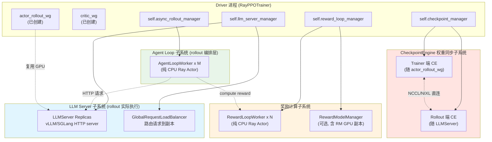

### 9.3 `RewardLoopManager`：奖励计算子系统

#### 解决什么问题

reward 有三种来源，常常混合使用：
1. **规则 reward**（math 答案验证、code 测试）—— 纯 CPU 计算
2. **生成式 reward 模型 (genrm)** —— GPU 上跑的 LLM
3. **判别式 reward 模型 (disrm)** —— GPU 上跑的分类器

如果 driver 串行计算会成为瓶颈。`RewardLoopManager` 把这件事独立成一个子系统。

#### 创建什么

```python
class RewardLoopManager:
    def __init__(self, config, rm_resource_pool=None):
        if config.reward.reward_model.enable:
            # 用 RM 时建 RewardModelManager（可能占独立 GPU 池）
            self.reward_model_manager = RewardModelManager(...)
            self.reward_router_address = self.reward_model_manager.get_router_address()

        # 创建 N 个 RewardLoopWorker —— 注意这些是 CPU Actor!
        self._init_reward_loop_workers()

    def _init_reward_loop_workers(self):
        num_workers = self.config.reward.num_workers
        for i in range(num_workers):
            node_id = node_ids[i % len(node_ids)]
            self.reward_loop_workers.append(
                RewardLoopWorker_cls.options(
                    name=f"reward_loop_worker_{i}",
                    scheduling_strategy=NodeAffinitySchedulingStrategy(node_id=node_id, soft=True),
                ).remote(self.config, self.reward_router_address)
            )
```

关键点：
- `RewardLoopWorker` 是 **纯 CPU Ray Actor**（不占 GPU）
- 数量由 `config.reward.num_workers` 决定（一般几十个，并行算 reward）
- 如果有 RM，这些 worker 通过 HTTP `reward_router_address` 远程调用 RM 服务

#### 与 actor 解耦：流式 reward

它和 `actor_rollout_wg` 完全解耦：
- actor_rollout_wg 在 GPU 上算策略
- RewardLoopWorker 在 CPU 上算 reward
- 两者**可以并行**：rollout 出一个样本就立刻送到 RewardLoopWorker 算分（流式 reward），不必等 batch 全部 rollout 完

这就是后面 `enable_agent_reward_loop` 标志要做的事（见 9.5）。

#### 使用路径：两种完全不同的调用模式 ★

`RewardLoopManager` 创建出来后，在整个训练流程中以**两条完全独立的路径**被使用，对应"流式"和"非流式"两种 reward 计算模式：

##### 路径 ①：流式 reward（`enable_agent_reward_loop=True`）

**触发条件**（`ray_trainer.py:852`）：
```python
enable_agent_reward_loop = (not self.use_rm) or self.config.reward.reward_model.enable_resource_pool
```
满足下列任一即触发：
- 没有 reward 模型（纯 rule-based reward）
- 有 reward 模型且**配了独立资源池**（不和 actor/rollout 抢 GPU）

**接线方式**（`ray_trainer.py:862-867`）：driver 不直接调，而是把 reward worker 的 ActorHandle 列表"嫁接"给 `AgentLoopManager`：
```python
reward_loop_worker_handles = self.reward_loop_manager.reward_loop_workers if enable_agent_reward_loop else None
self.async_rollout_manager = AgentLoopManager.create(
    ...,
    reward_loop_worker_handles=reward_loop_worker_handles,   # ★ 嫁接
)
```

**实际打分**：在 `AgentLoopWorker._compute_score`（`agent_loop.py:806-866`）里，每条轨迹生成完，随机挑一个 reward worker 异步算分：
```python
selected_reward_loop_worker_handle = random.choice(self.reward_loop_worker_handles)
result = await selected_reward_loop_worker_handle.compute_score.remote(data)
final_output.reward_score = result["reward_score"]
```

**效果**：rollout 还在跑下一条样本时，CPU 上已经在算前一条样本的 reward 了——rollout 与 reward **完全并行（流水线）**。

##### 路径 ②：非流式 reward（colocate）

**触发条件**：RM 启用、且**没有**独立资源池（与 actor/rollout 共享 GPU）。此时 `enable_agent_reward_loop=False`，`reward_loop_worker_handles=None`，AgentLoop 内部不做 reward。

**调用入口**（`ray_trainer.py:504-510`）：
```python
def _compute_reward_colocate(self, batch: DataProto):
    assert self.reward_loop_manager is not None
    batch_reward = self.reward_loop_manager.compute_rm_score(batch)
    return batch_reward
```

`_compute_reward_colocate` 在 `fit()` 中被 **三处** 调用：

| 调用点 | 行号 | 场景 |
|---|---|---|
| `_validate` 里 RM 模式 | 562 | 验证集需要 RM 打分 |
| ReMax baseline 计算 | 1396 | ReMax 算法的 greedy baseline rollout |
| 训练主循环 reward 阶段 | 1429 | 主流程：rollout 完给 batch 打 reward |

每一处调用之前都先 `checkpoint_manager.sleep_replicas()` 释放 rollout 显存让出给 RM，调用之后再 `update_weights` 唤醒 rollout。

**`compute_rm_score` 内部**（`reward_loop.py:323-346`）：
```python
def compute_rm_score(self, data: DataProto) -> DataProto:
    if self.reward_model_manager is not None:
        self.reward_model_manager.wake_up()              # 1. 唤醒 RM
    chunks = data.chunk(len(self.reward_loop_workers))    # 2. 整 batch 切片到 N 个 worker
    outputs = ray.get([
        worker.compute_score_batch.remote(chunk)
        for worker, chunk in zip(self.reward_loop_workers, chunks)
    ])                                                    # 3. 并发打分
    # 4. 拼成 rm_scores 张量 + reward_extra_info，包成 DataProto 返回
```

##### 两条路径对比表

| 维度 | 路径 ① 流式 | 路径 ② 非流式（colocate） |
|---|---|---|
| 触发条件 | 无 RM **或** RM 有独立资源池 | RM 启用且**无**独立资源池 |
| 调用入口 | `AgentLoopWorker._compute_score` | `RayPPOTrainer._compute_reward_colocate` |
| 调用方持有的对象 | reward worker `ActorHandle` 列表 | `reward_loop_manager` 整体 |
| 调用粒度 | 单条样本，`compute_score.remote(...)` | 整 batch 切片，`compute_score_batch.remote(...)` |
| 经过 `compute_rm_score` 吗 | ❌ 不经过 | ✅ 经过 |
| 与 rollout 关系 | **并行**（流水线，rollout 一条算一条） | **串行**（rollout → sleep → reward → wake） |
| 显存动作 | 无（reward worker 纯 CPU，RM 在独立池） | `sleep_replicas` → reward → `update_weights` |
| `fit()` 中可见调用点 | 无（藏在 rollout 内部） | 主循环 reward 阶段、validate、ReMax baseline |

##### 设计哲学一图

```
        ┌─────────────────────────────────────────┐
        │ RewardLoopManager（driver 进程持有）      │
        │  ├── reward_loop_workers: [Actor × N]   │  ← 同一组 CPU Actor
        │  └── reward_model_manager（可选, GPU）   │
        └─────────┬────────────────┬──────────────┘
                  │                 │
       path ②     │   path ①        │ 把 handle 列表
   compute_rm_    │                 │ 嫁接给 AgentLoopManager
   score(batch)   │                 │
                  ▼                 ▼
   ┌──────────────────────┐  ┌────────────────────────────┐
   │ fit() 主循环：driver  │  │ rollout 内部：AgentLoop 收  │
   │ 同步切片分发，等待结果 │  │ 到一条样本就 fire 一次      │
   │ 再继续下一步           │  │ compute_score.remote        │
   └──────────────────────┘  └────────────────────────────┘
        非流式（colocate）             流式（agent_reward_loop）
```

**关键认知**：`reward_loop_workers` 是**同一组 Ray Actor**——只是被以两种不同的"调用模式"消费：driver 同步切片调度 vs. AgentLoop 异步即时调用。这种"同一组资源、两种使用模式"的设计正是 verl 的精髓——`RewardLoopManager` 的职责是**统一管理这组 worker 的生命周期**，而具体何时调用、谁调用、是流水线还是同步，由训练 driver 根据资源池配置（`enable_resource_pool`）决定。

### 9.4 `LLMServerManager`：LLM HTTP 服务器子系统

#### 解决什么问题

`actor_rollout_wg` 已经在每张 GPU 上启动了 vLLM/SGLang，那为什么还要 `LLMServerManager`？

因为 vLLM 的最佳实践是**作为 HTTP/OpenAI-compatible server 运行**，而不是直接 Python 调用：
- 接收并发请求（多个 prompt 同时生成）
- 支持流式输出
- 做请求路由、负载均衡
- 与 agent loop（multi-turn）天然契合

`LLMServerManager` 就是把每张 GPU 上的 vLLM 包装成 HTTP server，并提供统一入口。

#### 8 GPU + TP=2 的具体例子

```
┌──────────────────────────────────────────────────────┐
│ actor_rollout_wg: 8 个 Ray Actor (GPU 0~7)           │
│ 每个 Actor 内部 self.rollout 是 vLLM worker          │
└──────────────────────────────────────────────────────┘
                    │
                    │ LLMServerManager 把它们组织成 HTTP server
                    ▼
┌──────────────────────────────────────────────────────┐
│ Replica 0:           Replica 1:                       │
│ ┌──────────┐         ┌──────────┐                     │
│ │ GPU 0,1  │         │ GPU 2,3  │  ...                │
│ │ vLLM TP2 │         │ vLLM TP2 │                     │
│ │ HTTP :8000          │ HTTP :8001                    │
│ └──────────┘         └──────────┘                     │
│      ▲                    ▲                           │
│      │                    │                           │
│   ┌──┴────────────────────┴──┐                        │
│   │ GlobalRequestLoadBalancer │                       │
│   │ (Ray Actor)               │                       │
│   └───────────────────────────┘                       │
│                ▲                                      │
└────────────────┼──────────────────────────────────────┘
                 │ get_client() 返回 LLMServerClient
                 │
            Driver 上用 client.generate(prompt) 发请求
```

#### 关键：`init_hybrid` 复用 worker_group

```python
LLMServerManager(worker_group=self.actor_rollout_wg, ...)
```

**不创建新 GPU 进程**，而是把 `actor_rollout_wg` 内部已经存在的 `self.rollout` 对象（vLLM 实例）暴露成 HTTP 端口。这就是 HybridEngine 的关键 —— 物理 GPU 进程只有一份。

### 9.5 `AgentLoopManager`：异步 Rollout 编排层

> **重要澄清：普通 RL（GRPO/PPO）也走这一层！** 它不是只为 agentic RL 服务的。

#### 解决什么问题

`LLMServerManager` 提供的是**一次 generate** 的能力。但现代 RL 训练有更复杂需求：
- **Multi-turn**：模型生成 → 调 tool → 把 tool 结果拼回 prompt → 继续生成
- **Tool calling**：解析模型输出里的 `<tool_call>...</tool_call>` 调外部工具
- **流式 reward**：每个样本生成完立刻打分，不等整 batch
- **Async rollout**：不同 prompt 异步并发跑（有的长有的短）

这些"编排逻辑"如果写在 driver 里会非常复杂。`AgentLoopManager` 就是专门做这件事的。

#### 它创建什么

```python
async def _init_agent_loop_workers(self):
    num_workers = self.rollout_config.agent.num_workers
    for i in range(num_workers):
        node_id = node_ids[i % len(node_ids)]
        # 创建 AgentLoopWorker —— 纯 CPU Ray Actor!
        self.agent_loop_workers.append(
            AgentLoopWorker_cls.options(
                name=f"agent_loop_worker_{i}_...",
                scheduling_strategy=NodeAffinitySchedulingStrategy(node_id=node_id, soft=True),
            ).remote(
                self.config,
                self.llm_client,                    # 转给 worker，让它发 HTTP 请求
                self.teacher_client,
                self.reward_loop_worker_handles,    # 如果传了，就流式算 reward
            )
        )
```

关键设计：
- `AgentLoopWorker` 是 **CPU Ray Actor**（不占 GPU）
- 数量由 `config.actor_rollout_ref.rollout.agent.num_workers` 决定
- 每个 worker 拿到 `llm_client`（请求 vLLM HTTP）和 `reward_loop_worker_handles`（请求 reward 计算）
- 它在 CPU 上做"编排"，通过 HTTP 把活派给 GPU 上的 vLLM

#### `generate_sequences` 实际入口就是它

回顾 `fit()` 训练循环：

```python
combined_gen_output = self.async_rollout_manager.generate_sequences(combined_gen_batch)
```

driver 调的不是 `actor_rollout_wg.generate_sequences`，而是 `async_rollout_manager.generate_sequences`！

实现：
```python
async def generate_sequences(self, prompts: DataProto) -> DataProto:
    chunkes = prompts.chunk(len(self.agent_loop_workers))
    # 把 prompts 切给 N 个 AgentLoopWorker 并发处理
    outputs = await asyncio.gather(*[
        worker.generate_sequences.remote(chunk)
        for worker, chunk in zip(self.agent_loop_workers, chunkes)
    ])
    return DataProto.concat(outputs)
```

#### **关键澄清：普通 RL 也走 AgentLoopManager**

这个命名容易让人误以为只为 agentic RL 服务。**实际上普通 GRPO/PPO 也走这一层**，通过下面机制：

##### 9.5.1 `SingleTurnAgentLoop`：给"非 agent"任务用的

`verl/experimental/agent_loop/single_turn_agent_loop.py`：

```python
@register("single_turn_agent")
class SingleTurnAgentLoop(AgentLoopBase):
    """Naive agent loop that only do single turn chat completion."""

    async def run(self, sampling_params, **kwargs):
        messages = list(kwargs["raw_prompt"])
        prompt_ids = await self.apply_chat_template(messages, ...)

        # 直接调 vLLM 生成（一次，不循环）
        output: TokenOutput = await self.server_manager.generate(
            request_id=uuid4().hex,
            prompt_ids=prompt_ids,
            sampling_params=sampling_params,
        )
        response_mask = [1] * len(output.token_ids)        # 全 1，没有 tool 观察 token

        return AgentLoopOutput(
            prompt_ids=prompt_ids,
            response_ids=output.token_ids[: self.response_length],
            response_mask=response_mask[: self.response_length],
            num_turns=2,                                    # 1 user + 1 assistant
            ...
        )
```

这就是普通 GRPO/PPO 训练时实际跑的 agent loop——它根本不"agentic"，只是一次单纯的 LLM 生成。

##### 9.5.2 默认值机制

`agent_loop.py:493-495`：

```python
# by default, we assume it's a single turn agent
if "agent_name" not in batch.non_tensor_batch:
    default_agent_loop = config.agent.default_agent_loop
    batch.non_tensor_batch["agent_name"] = np.array([default_agent_loop] * len(batch), dtype=object)
```

dataset 里没指定 `agent_name` 的话，默认走 `config.agent.default_agent_loop`，默认就是 `"single_turn_agent"`。

##### 9.5.3 注册表机制

verl 用注册表把 agent 名字映射到具体类：

| `agent_name` | 用哪个类 | 适用场景 |
|---|---|---|
| `single_turn_agent`（默认） | `SingleTurnAgentLoop` | 普通 RL（GRPO/PPO/RLOO/...）—— 单轮生成 |
| `tool_agent` | `ToolAgentLoop` | Tool calling RL |
| 自定义 | 用户注册的类 | Multi-turn / search agent / code agent / ... |

##### 9.5.4 为什么这样设计：单轮 RL 是 multi-turn 的特例

verl 这套设计是**"统一异步框架，特殊化退化"**的思路：
- **Tool agent**：用户消息 → 模型生成 → 调 tool → 拼回 → 再生成 → ...（多轮循环）
- **Single turn**：用户消息 → 模型生成（1 轮就结束）

数学上 single turn 就是 multi-turn 的边界情况（`num_turns=1`）。

哪怕是单轮 GRPO，把 rollout 放在 `AgentLoopManager` 里也有重要好处：

| 好处 | 说明 |
|---|---|
| **样本级并发** | 一个 batch 里 256 个 prompt，256 个 `asyncio.task` 并发跑，谁先完谁走 |
| **流式 reward** | 一个样本生成完立刻送 `RewardLoopWorker` 算分（CPU/GPU 并行） |
| **样本级长度差异容忍** | 长 prompt 不阻塞短 prompt（不像 sync batch 必须等最长的） |
| **统一编程模型** | 切换到 multi-turn / tool 只需换 agent_name，业务代码零改动 |

##### 9.5.5 命名争议

```python
self.async_rollout_manager = AgentLoopManager.create(...)
```

**变量名是 `async_rollout_manager`，但类名是 `AgentLoopManager`**。这暗示了它的双重身份：
- **从底层架构看**：它是 async rollout manager（异步 rollout 编排器）
- **从业务能力看**：它是 agent loop manager（支持 agent loop 的能力）

可以理解为："我是一个能跑 agent loop 的异步 rollout 管理器，单轮场景下退化成普通 rollout"。

verl 早期是有 sync rollout 模式的（直接 driver 调 `actor_rollout_wg.generate_sequences`），后来发现 async 模式综合更优，就把 sync 模式废弃了：

```python
# ray_trainer.py:825
# create async rollout manager and request scheduler
# Note: mode is always "async" since sync mode is deprecated
self.async_rollout_mode = True
```

##### 9.5.6 每条轨迹独立实例化 `agent_loop` 的设计权衡

看 `AgentLoopWorker._run_agent_loop`（`agent_loop.py:565-577`）：

```python
agent_loop_config = _agent_loop_registry[agent_name]
agent_loop = hydra.utils.instantiate(           # ★ 每条轨迹都新建一个
    config=agent_loop_config,
    trainer_config=DictConfigWrap(config=self.config),
    server_manager=self.llm_client,             # ← 引用，不是新建
    tokenizer=self.tokenizer,                   # ← 引用
    processor=self.processor,                   # ← 引用
    dataset_cls=self.dataset_cls,
    data_config=DictConfigWrap(self.config.data),
    tools=ToolListWrap(self.tools),             # ← 引用
)
output: AgentLoopOutput = await agent_loop.run(sampling_params, **kwargs)
```

**每条轨迹都会新建一个 `agent_loop` 实例**，这看似低效，但实际是合理设计。

**▶ 数据流：batch 已经 ×rollout_n**

看 `ray_trainer.py:1355-1378`：

```python
rollout_n = self.config.actor_rollout_ref.rollout.n
gen_batch_output = gen_batch.repeat(repeat_times=rollout_n, interleave=True)   # ★ 先 ×N
...
combined_gen_output = self.async_rollout_manager.generate_sequences(combined_gen_batch)
```

数据量级追踪（假设 `batch_size=256, rollout_n=8, num_workers=8`）：

```
原始 batch = 256                              (driver 从 dataloader 读到的)
   │
   ▼  gen_batch.repeat(rollout_n=8, interleave=True)
×8 后 = 2048                                   (combined_gen_batch)
   │
   ▼  AgentLoopManager.generate_sequences(combined_gen_batch)
   │  内部 chunk 给 num_workers 个 AgentLoopWorker
   ▼
每个 AgentLoopWorker 收到 chunk_size = 2048 / 8 = 256
   │
   ▼  for i in range(len(chunk)):  256 次循环
   ▼  每次 asyncio.create_task(self._run_agent_loop(...))
每个 worker 创建 256 个 agent_loop 实例
所有 worker 加起来 = 256 × 8 = 2048 个实例
```

**关键点：每条独立轨迹一个实例。** `interleave=True` 让同一个 prompt 的 N 次采样在 batch 中相邻 → vLLM KV cache 命中率高 → 后续按 `uid` 分组算 GRPO advantage。

**▶ 为什么不复用单个实例？**

**理由 1：`agent_loop` 持有"轨迹级状态"**

看 `tool_agent_loop.py` 的 `AgentData`：

```python
class AgentData:
    """Encapsulates all state variables for the agent loop."""
    def __init__(self, messages, image_data, ..., request_id, ...):
        self.messages = messages
        ...
        # State variables
        self.prompt_ids: list[int] = []
        self.response_ids: list[int] = []
        self.response_mask: list[int] = []
        self.response_logprobs: list[float] = []
        self.turn_scores: list[float] = []
        self.tool_rewards: list[float] = []
```

每个 `agent_loop` 实例对应一条完整轨迹（多轮 messages、累积的 response_ids、tool 调用结果、中间 reward）。**两条轨迹共用同一实例必然状态污染**。

**理由 2：必须支持 `asyncio` 并发**

`asyncio.gather([task1, task2, ...])` 让多个 task 在同一个 worker 上并发等 HTTP 响应（I/O bound）。如果共用一个 `agent_loop`，多个 task 会同时改写 `self.messages`，必然冲突。

每条轨迹独立实例 → 每条轨迹有独立状态空间 → 完美支持 asyncio 并发。

**▶ 实例化开销其实可以忽略**

`AgentLoopBase.__init__` 里所有"重资源"都是从 `AgentLoopWorker` **传引用**过来的：

```python
def __init__(self, trainer_config, server_manager, tokenizer, processor, ...):
    self.config = trainer_config.config           # ← 引用
    self.server_manager = server_manager          # ← 引用，AgentLoopWorker 已持有
    self.tokenizer = tokenizer                    # ← 引用
    self.processor = processor                    # ← 引用
    ...
    self.system_prompt = initialize_system_prompt(...)   # 内部 LRU cache
```

构造一个 `agent_loop` 本质只是：创建 Python 对象 + 拷贝几个引用 + 一次 `system_prompt` 计算（有 cache）。**没有 IO、没有模型加载、没有 tool 加载。**

**▶ 分层初始化策略**

| 层级 | 频次 | 干什么 | 开销 |
|---|---|---|---|
| `AgentLoopWorker.__init__` | **每个 worker 一次**（启动时） | load tokenizer / processor / tools / chat template / agent_loop_registry | 几秒 |
| `agent_loop = hydra.utils.instantiate(...)` | **每条轨迹一次** | 拿一堆引用 + 算 system_prompt | 几毫秒 |
| `agent_loop.run()` | **每条轨迹的实际执行** | LLM 调用、tool 调用、状态累积 | 几秒~几十秒 |

`AgentLoopWorker.__init__` 里有一行注释明确表达了这种分层意图：

```python
# Load tools once per worker; each trajectory just reuses self.tools.
self.tools = load_all_tools(...)
```

**实例化开销占比 < 1%**，相对于 LLM HTTP 调用延迟可以忽略。这是典型的**"重对象单例 + 轻对象每次实例化"**设计模式 —— 用极小的实例化代价换取并发安全和代码清晰。

**▶ 为什么用 `hydra.utils.instantiate`？**

注册表里存的不是类对象，而是**全限定名字符串**：

```python
_agent_loop_registry: dict[str, dict] = {}

def register(agent_name: str):
    def decorator(subclass):
        fqdn = f"{subclass.__module__}.{subclass.__qualname__}"
        _agent_loop_registry[agent_name] = {"_target_": fqdn}    # ★ 字符串
        return subclass
    return decorator
```

好处：
1. **支持配置文件动态扩展**：用户写 yaml 注册新 agent_loop，verl 不需要改代码
2. **延迟导入**：自定义 agent_loop 只有在用到时才 import，避免启动时全部加载

**▶ `ToolListWrap` / `DictConfigWrap` 的作用**

```python
class ToolListWrap:
    """Avoid hydra.utils.instantiate to recursively instantiate the tools list."""
    def __init__(self, tools: list):
        self.tools = tools
```

hydra `instantiate` 在递归处理 dict-like 对象时会试图 instantiate 它们。这两个 wrap 类用 `__init__` 把对象藏起来，避免被 hydra 误处理。**零开销**的语法包装，不是真创建对象。

#### `enable_agent_reward_loop` 的意义

```python
enable_agent_reward_loop = not self.use_rm or self.config.reward.reward_model.enable_resource_pool
```

只有当下面两个条件之一满足时，才把 `reward_loop_worker_handles` 传给 agent loop（启用流式 reward）：
1. **不用 RM**（纯规则 reward）—— rollout 阶段就能流式算 reward
2. **RM 占独立 GPU 池** —— RM 不和 actor 抢资源，可以并行

否则 RM 必须和 actor colocate，rollout 时 RM 还在睡，无法流式算分。

#### 调用关系全图

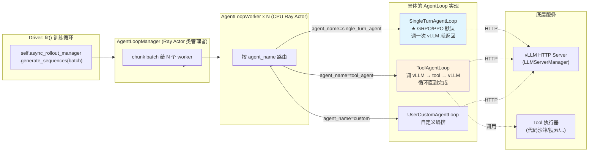

### 9.6 `CheckpointEngineManager`：训练-推理权重同步子系统

#### 解决什么问题

每个训练步结束后，actor 模型更新了，但 vLLM 里跑的还是旧权重。要把训练侧权重同步到推理侧 —— 在传统 RLHF 框架里要走 CPU/磁盘，**慢且占内存**。

verl 的解法：**GPU 直连同步**（NCCL / NIXL / Mooncake 等 backend 选）。

#### 核心数据结构

源码注释里画得很清楚：

```
┌────────┬────────┬─────┬────────┐         ┌───────────────────┬───────────────────┐
│ ┌────┐ │ ┌────┐ │     │ ┌────┐ │         │     Replica 0     │     Replica 1     │
│ │ ME0│ │ │ ME1│ │     │ │ MEn│ │         ├────┬────┬────┬────┼────┬────┬────┬────┤
│ └──┬─┘ │ └────┘ │ ... │ └────┘ │         │ 0  │ 1  │ 2  │ 3  │ 0  │ 1  │ 2  │ 3  │
│    v   |        |     |        |         └──┬─┴──┬─┴──┬─┴──┬─┴──┬─┴──┬─┴──┬─┴──┬─┘
| ┌──┴─┐ │ ┌────┐ │     │ ┌────┐ │            ^    ^    ^   cuda ipc   ^    ^    ^
│ │ CE │ │ │ CE │ │     │ │ CE │ │         ┌──┴─┬──┴─┬──┴─┬──┴─┬──┴─┬──┴─┬──┴─┬──┴─┐
│ └──┬─┘ │ └────┘ │     │ └────┘ │         │ CE │ CE │ CE │ CE │ CE │ CE │ CE │ CE |
└────┼───┴────────┴─────┴────────┘         └──┬─┴──┬─┴──┬─┴──┬─┴──┬─┴──┬─┴──┬─┴──┬─┘
     v                                        |    |    |    |    |    |    |    |
     └─────────────(nccl/nixl/..)─────────────┴────┴────┴────┴────┴────┴────┴────┘
```

- **ME (Model Engine)**：FSDP/Megatron 训练后端，能 `get_per_tensor_param` 流式吐参数
- **CE (Checkpoint Engine)**：通信中间层，建立训练侧和推理侧的通信组
- **训练侧**：ME 和 CE 在同一进程
- **推理侧**：CE 和 vLLM worker 在不同进程，通过 **CUDA IPC** 共享显存

#### 调用链

训练循环里的：
```python
self.checkpoint_manager.update_weights(self.global_steps)
```

实际做了：
1. 通过 `trainer.execute_checkpoint_engine` 让所有训练 worker 准备 send
2. 通过 `replica.execute_checkpoint_engine` 让所有 rollout 副本准备 recv
3. NCCL/NIXL **GPU→GPU 直传**（不经 CPU）
4. 推理侧 CE 通过 CUDA IPC 把新权重交给 vLLM

`sleep_replicas()`（行 884）在初始化最后调用：因为加载 checkpoint 时 vLLM 还没准备好，先把它睡了释放显存。等到训练循环开始，第一次 `update_weights` 才唤醒。

### 9.7 完整 `init_workers` 流程（更新版）

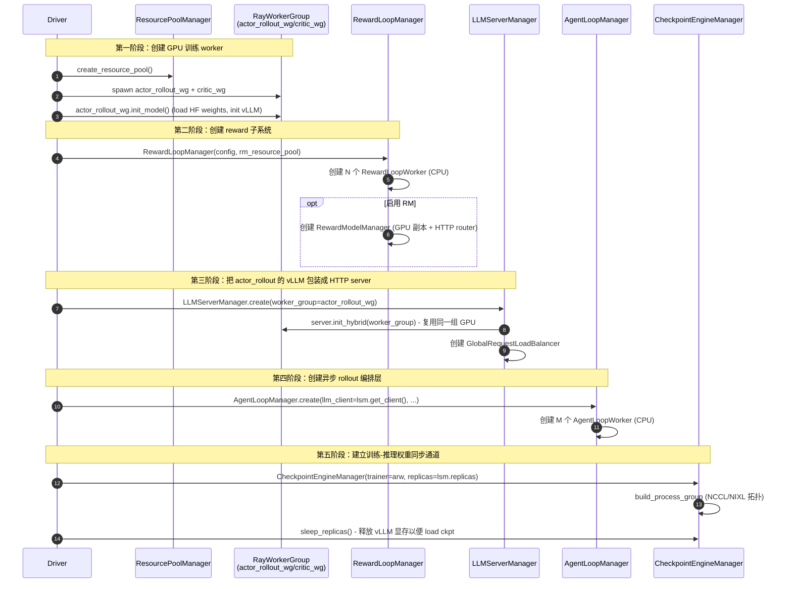

### 9.8 关注点分离的设计哲学

为什么这些不放在 `actor_rollout_wg` 里？答案是 **关注点分离**：

| 管理器 | 关注的维度 |
|---|---|
| `actor_rollout_wg` | **GPU 进程的生命周期**（哪些 worker 跑在哪些 GPU） |
| `LLMServerManager` | **服务化**（HTTP server、负载均衡） |
| `AgentLoopManager` | **业务逻辑**（multi-turn、tool、异步） |
| `CheckpointEngineManager` | **跨进程通信**（NCCL/NIXL 拓扑） |
| `RewardLoopManager` | **打分逻辑**（CPU 编排 + RM HTTP 调用） |

每个管理器只关心自己的事，不互相耦合。要换 rollout 后端（vLLM → SGLang）只动 `LLMServerManager`，要加 tool calling 只动 `AgentLoopManager`，互不影响。

### 9.9 训练循环中各管理器的使用

回到 `fit()` 训练循环对照：

```python
# Step 1. Rollout —— 用 AgentLoopManager
combined_gen_output = self.async_rollout_manager.generate_sequences(combined_gen_batch)

# 流式 reward 已在 agent_loop_worker 内部跑过了
# 如果非流式，下面这行触发非流式 reward 路径
if self.use_rm and "rm_scores" not in batch.batch.keys():
    batch_reward = self._compute_reward_colocate(batch)   # 用 RewardLoopManager.compute_rm_score

# Step 9. 权重同步 —— 用 CheckpointEngineManager
self.checkpoint_manager.update_weights(self.global_steps)

# rollout 完毕 sleep —— 用 CheckpointEngineManager
self.checkpoint_manager.sleep_replicas()
```

---

## 十、数据准备层（Dataset / DataLoader / 普通 RL vs Agentic RL）

verl 的数据准备非常薄——一个 `RLHFDataset` + 一个 `collate_fn` + 一个 `StatefulDataLoader` 就把"从 parquet 到训练循环吃的 batch"链路打通了。这一章把这条链路、数据格式、以及普通 RL / Agentic RL 的数据差异讲透。

### 10.1 `_create_dataloader` 五步走读（`ray_trainer.py:320-401`）

```python
# Step 1：从 main_ppo 取工厂
from verl.trainer.main_ppo import create_rl_dataset, create_rl_sampler

# Step 2：构造 train / val 数据集（默认 RLHFDataset，支持 custom_cls 注入）
train_dataset = create_rl_dataset(self.config.data.train_files, self.config.data, ...)
val_dataset   = create_rl_dataset(self.config.data.val_files,   self.config.data, ...)

# Step 3：sampler（resume 友好的 RandomSampler / SequentialSampler）
train_sampler = create_rl_sampler(self.config.data, self.train_dataset)

# Step 4：collate_fn —— 把 List[dict] 打平为 dict[str, Tensor/np.ndarray]
from verl.utils.dataset.rl_dataset import collate_fn

# Step 5：StatefulDataLoader（来自 torchdata，支持迭代器断点续训）
self.train_dataloader = StatefulDataLoader(
    dataset=train_dataset,
    batch_size=self.config.data.get("gen_batch_size", self.config.data.train_batch_size),  # ★
    num_workers=...,
    drop_last=True,
    collate_fn=collate_fn,
    sampler=train_sampler,
)

# 回写 total_training_steps 给 actor.optim / critic.optim 用作 LR scheduler
```

| 设计点 | 说明 |
|---|---|
| `gen_batch_size or train_batch_size` | 允许 rollout 阶段用更大的 batch（推理 batch 通常可远大于训练 batch） |
| `drop_last=True`（train） | 保证每 step batch size 恒定，方便 DP 切分 |
| `StatefulDataLoader` | 来自 `torchdata`，可 `state_dict()` / `load_state_dict()`，断点续训不丢样本 |
| `validation_shuffle` 默认 True | val 也 shuffle，方便采样可视化（不影响指标） |
| `total_training_steps` 回写 | actor/critic 的 LR scheduler 需要它 |
| `get_dataset_class` 工厂 | 配 `data.custom_cls.{path,name}` 可注入自定义 `Dataset` 子类 |

### 10.2 数据集物理格式（`RLHFDataset`）

**物理文件**：Parquet（推荐）或 JSON/JSONL，由 `datasets.load_dataset(...)` 加载，多文件 `concatenate_datasets` 拼接。

**单条样本 schema**：
```jsonc
{
  // ───── 必填 ─────
  "prompt": [                            // 由 config.data.prompt_key（默认 "prompt"）指定
    {"role": "system",  "content": "You are a helpful assistant."},
    {"role": "user",    "content": "What is 1+1?"}
  ],                                     // OpenAI chat format：list[dict]

  // ───── 强烈建议 ─────
  "data_source": "openai/gsm8k",         // reward 函数路由用
  "reward_model": {                      // 给 reward 模块的"标准答案"
    "style": "rule",                     //   "rule" / "model"
    "ground_truth": "2"
  },

  // ───── 可选 ─────
  "extra_info": {
    "index": 12345,                      // 样本唯一 id（agent_loop trace key）
    "tools_kwargs": { ... },             // Agentic RL：多轮 tool 调用的初始参数
    "interaction_kwargs": { ... },       // Agentic RL：多轮交互回调参数
    "need_tools_kwargs": true            // 标记本条是否需要 tools_kwargs
  },

  // ───── 多模态（按需） ─────
  "images": [PIL.Image 或 {"bytes": b"..."}],  // prompt 里用 "<image>" 占位
  "videos": [{...}],                            //             "<video>"
  "audios": [{...}]                             //             "<audio>"
}
```

### 10.3 `__getitem__` → `collate_fn` → `batch_dict` → `DataProto` 全链路

#### Step A：`RLHFDataset.__getitem__` 产出 row_dict
```python
{
  "data_source":  "openai/gsm8k",
  "reward_model": {"style": "rule", "ground_truth": "2"},
  "extra_info":   {"index": 12345, ...},

  # RLHFDataset 自己加的
  "raw_prompt":         [{"role": ..., "content": ...}, ...],  # 已替换多模态占位
  "index":              12345,
  "tools_kwargs":       {...},
  "interaction_kwargs": {...},
  "dummy_tensor":       torch.tensor([0], dtype=uint8),        # 占位防止 DataProto.batch 为空
}
```

> ⚠️ 关键：**`raw_prompt` 没有 tokenize**！verl 把 tokenize / apply_chat_template 推迟到 `AgentLoop`（如 `SingleTurnAgentLoop.run`）里做，这样多模态 / tool schema 在 rollout 时再渲染，灵活度最高。

#### Step B：`collate_fn`（`rl_dataset.py:40`）打平 batch
规则极其简单：
- tensor 字段 → `torch.stack` 成 `[B, ...]` 的 batched tensor
- 非 tensor 字段 → `np.fromiter(dtype=object)` 成 `shape=[B]` 的 object 数组

```python
batch_dict = {
  "dummy_tensor":       torch.Tensor [B, 1],
  "raw_prompt":         np.array([list, list, ...], dtype=object),
  "data_source":        np.array(["openai/gsm8k", ...]),
  "reward_model":       np.array([{...}, ...]),
  "extra_info":         np.array([{...}, ...]),
  "index":              np.array([12345, ...]),
  "tools_kwargs":       np.array([{...}, ...]),
  "interaction_kwargs": np.array([{...}, ...]),
}
```

#### Step C：训练循环入口包装
```python
# ray_trainer.py:1343  ——  主线
batch: DataProto = DataProto.from_single_dict(batch_dict)

# main_ppo_sync.py:1631  ——  TQ 线
batch_dict["uid"] = np.array([str(uuid.uuid4()) for _ in range(...)], dtype=object)
batch: TensorDict = tu.get_tensordict(batch_dict)
```

`DataProto` 的双结构（`batch` tensordict + `non_tensor_batch` object array）与 `collate_fn` 输出**天然对齐**，无需额外转换。

### 10.4 普通 RL vs Agentic RL：数据集差异对比

**核心结论：物理 schema 完全一样**（都是 `RLHFDataset` + parquet）。差异只在内容上：

| 维度 | 普通 RL（math/QA/reasoning） | Agentic RL（tool-use / multi-turn） |
|---|---|---|
| `prompt` | system + user 两轮，单回合 | **同样**的 system + user 单回合（**多轮过程不在数据里**！） |
| `extra_info.tools_kwargs` | 缺省 / `{}` | **必填**，如 `{"calc_tool": {"max_calls": 5}}` |
| `extra_info.interaction_kwargs` | 不需要 | 可选，多轮交互的回调状态 |
| `extra_info.need_tools_kwargs` | False / 不设 | True（缺失会触发 warning） |
| `agent_name` 列 | 不需要 | 单 agent 不需要、多 agent 必需（见 §10.5） |
| 配置 `actor_rollout_ref.rollout.agent.default_agent_loop` | `single_turn_agent`（默认） | `tool_agent` / 自定义 agent 名 |
| 配置 `tool_config_path` / `function_tool_path` | 不设 | **必设**，注册可用工具 schema |
| rollout 时实际走的 `AgentLoop` 子类 | `SingleTurnAgentLoop` | `ToolAgentLoop`（循环 generate → 检测 tool_call → 执行 → 喂回） |
| 最终 `response_mask` | 全 1（每个 token 都是 LLM 生成的） | 0/1 交错（**tool 返回的 observation token 为 0**，不算 actor loss） |
| 数据集 `__init__` 行为 | `tool_schemas=None` | 加载 `tool_config_path → tool_schemas`，过滤超长 prompt 时把 schema 也算进 token 数 |

#### 形象对比

```jsonc
// 普通 RL 样本
{
  "data_source": "openai/gsm8k",
  "prompt":      [{"role":"system","content":"Solve step by step..."},
                  {"role":"user","content":"Lily has 12 apples..."}],
  "reward_model":{"style":"rule","ground_truth":"7"},
  "extra_info":  {"index": 314}
}

// Agentic RL 样本（calculator tool）
{
  "data_source": "tool/math_tool",
  "prompt":      [{"role":"system","content":"You can use calc tool..."},
                  {"role":"user","content":"Compute (123*456+789)/7"}],
  "reward_model":{"style":"rule","ground_truth":"8128.857..."},
  "extra_info":  {
    "index": 999,
    "need_tools_kwargs": true,
    "tools_kwargs":      {"calc_tool": {"max_calls": 5}}
  }
}
```

> **划重点**：Agentic RL 的多轮过程**不出现在数据集里**！数据集只有"任务初始 prompt + tool 配置"，多轮对话由 `ToolAgentLoop` 在 rollout 阶段动态生成。这是 verl agentic 的核心设计——**数据集保持简洁，复杂度全在 rollout loop**。

### 10.5 `agent_name` 字段的三层兜底机制

关键代码（`agent_loop.py:493-495`）：
```python
if "agent_name" not in batch.non_tensor_batch:
    default_agent_loop = config.agent.default_agent_loop
    batch.non_tensor_batch["agent_name"] = np.array(
        [default_agent_loop] * len(batch), dtype=object
    )
```

三层兜底：

```
┌──────────────────────────────────────────────────────────────────────┐
│  1. 数据集 row_dict 含 "agent_name" 字段？                            │
│     ├── 是 → 直接用（支持每条样本不同 agent）                        │
│     └── 否 → 走第 2 层                                                │
│                                                                       │
│  2. config.actor_rollout_ref.rollout.agent.default_agent_loop          │
│     默认："single_turn_agent"（rollout.yaml:237）                     │
│     全 batch 一刀切填充                                               │
│                                                                       │
│  3. 在 _agent_loop_registry 里按字符串查类：                          │
│     ├── "single_turn_agent" → SingleTurnAgentLoop                     │
│     ├── "tool_agent"        → ToolAgentLoop                           │
│     └── 自定义（用 @register("xxx") 注册的子类）                      │
└──────────────────────────────────────────────────────────────────────┘
```

注册机制（`agent_loop.py:359`）：
```python
def register(agent_name: str):
    def decorator(subclass: type[AgentLoopBase]) -> type[AgentLoopBase]:
        fqdn = f"{subclass.__module__}.{subclass.__qualname__}"
        _agent_loop_registry[agent_name] = {"_target_": fqdn}
        return subclass
    return decorator

# verl/experimental/agent_loop/single_turn_agent_loop.py
@register("single_turn_agent")
class SingleTurnAgentLoop(AgentLoopBase): ...

# verl/experimental/agent_loop/tool_agent_loop.py
@register("tool_agent")
class ToolAgentLoop(AgentLoopBase): ...
```

**三种典型使用场景**：

| 场景 | 数据集是否需要 `agent_name` 列 | YAML 改动 |
|---|---|---|
| 普通 RL（数学/QA） | ❌ 不需要 | 默认值即可 |
| 纯 Agentic RL（所有样本同一 agent） | ❌ 不需要 | 改 `default_agent_loop: tool_agent` |
| 混合 Agentic RL（多 agent 共训练） | ✅ **必须** | 默认值仅作 fallback |

> ⚠️ **踩坑提醒**：`if "agent_name" not in batch.non_tensor_batch` 是**整列存在性检查**，不是逐元素判断。**不要在数据集里部分样本带 / 部分样本不带**——要么全带，要么全不带。

### 10.6 关键认知：`AgentLoop.run` 收到的是"单条样本"

外层 `AgentLoopWorker.generate_sequences` 在 `agent_loop.py:526-536`：
```python
for i in range(len(batch)):                                  # ★ 逐条样本展开
    kwargs = {k: v[i] for k, v in batch.non_tensor_batch.items() if k != "__do_sample__"}
    #         ↑↑↑ 对 batch 每个 non_tensor 字段取第 i 个元素 → 单样本 kwargs
    tasks.append(asyncio.create_task(
        self._run_agent_loop(sample_sampling_params, trajectory_info[i], ..., **kwargs)
    ))
outputs = await asyncio.gather(*tasks)                       # 并发后拼回
```

`_run_agent_loop` 实例化对应 `AgentLoop` 子类，调：
```python
output: AgentLoopOutput = await agent_loop.run(sampling_params, **kwargs)
```

到 `SingleTurnAgentLoop.run`（`single_turn_agent_loop.py:38-39`）：
```python
async def run(self, sampling_params: dict[str, Any], **kwargs) -> AgentLoopOutput:
    messages = list(kwargs["raw_prompt"])     # ★ kwargs["raw_prompt"] 是单条 message list
```

`kwargs["raw_prompt"]` 在这里**不是** `np.array`，而是 **那一条样本的 message list 本身**——因为外层做了 `v[i]` 切片。所有后续处理（apply_chat_template、process_multi_modal_info、generate、AgentLoopOutput）都是单样本粒度。

> **粒度总结**：`AgentLoopWorker` 是 batch 粒度（`ray.remote` Actor，一进程多任务）；`AgentLoop` 子类 + `run` 是**轨迹粒度**（一条样本一个独立 asyncio.Task）。

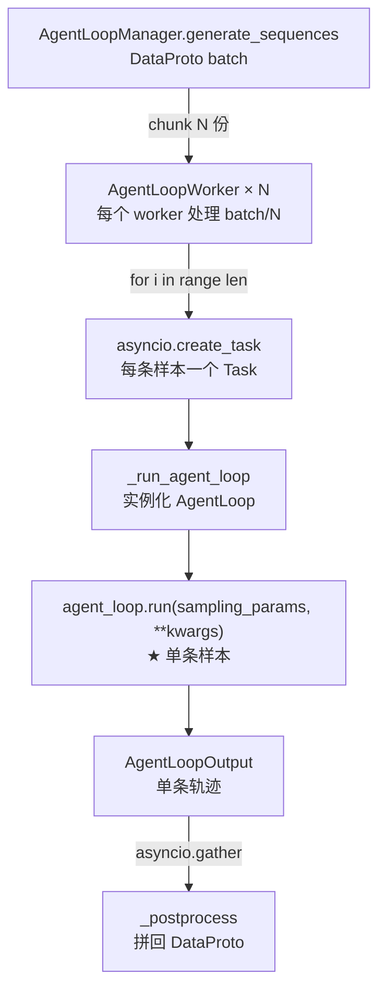

### 10.7 `main_ppo_sync` 对数据集的适配性：零侵入

**结论：`main_ppo_sync.py` 完全复用主线数据准备链路，数据集不用动一个字段。**

证据 1：导入的是同一份工厂
```python
# main_ppo_sync.py:71
from verl.trainer.main_ppo import create_rl_dataset, create_rl_sampler, run_ppo
# main_ppo_sync.py:89
from verl.utils.dataset.rl_dataset import collate_fn
```

证据 2：`_init_dataloader` 跟 `_create_dataloader` 几乎逐字相同
```python
self.train_dataloader = StatefulDataLoader(
    dataset=self.train_dataset,
    batch_size=self.config.data.get("gen_batch_size", self.config.data.train_batch_size),
    num_workers=...,
    drop_last=True,
    collate_fn=collate_fn,                # ★ 同一个 collate_fn
    sampler=create_rl_sampler(self.config.data, self.train_dataset),
)
```

证据 3：分叉点在 `batch_dict` 之后才发生

```
                    ┌──────────────────────────────────────┐
                    │  RLHFDataset                         │   ← 同一份代码、同一份 parquet
                    │  __getitem__ → row_dict              │
                    └─────────────────┬────────────────────┘
                                      │
                    ┌─────────────────▼────────────────────┐
                    │  collate_fn                          │   ← 同一份
                    │  → batch_dict                        │
                    └──────┬─────────────────────────┬─────┘
                           │                         │
   main_ppo.py 主线        │                         │  main_ppo_sync.py 异步线
                           ▼                         ▼
       DataProto.from_single_dict          tu.get_tensordict + uid
                           │                         │
                           ▼                         ▼
       DataProto 整条流水线        rollout → TransferQueue
                                  driver 持 KVBatchMeta 当游标
```

**迁移到 main_ppo_sync.py 时数据集 / parquet 完全不用动**，普通 RL / Agentic RL 都可以无缝迁移。

### 10.8 一句话总结

> verl 的数据准备层薄而锐利：**一份 `RLHFDataset` + 一份 `collate_fn` + 一份 `StatefulDataLoader`** 横跨普通 RL、Agentic RL、main_ppo / main_ppo_sync 四种场景。数据集**只存任务初始 prompt + 工具配置**，复杂度（多轮对话、tool 调用、tokenize、多模态渲染）全部下沉到 `AgentLoop` 子类的 `run`（单样本粒度）。要新增一种训练范式，只需写一个新的 `@register("xxx") class XxxAgentLoop(AgentLoopBase)`，数据集层零改动。

---

## 十一、`fit()` 训练循环数据流

> 第十一章是 verl 训练逻辑的核心。先从 §11.1 的"骨架速记版"建立全局直觉，再用 §11.3 的"逐步精读"逐行对照源码，§11.4 收束设计哲学，§11.5 给一个完整 step 的时间轴。

### 11.1 速记版主循环（`ray_trainer.py:1274`）

```python
def fit(self):
    self._load_checkpoint()
    self.checkpoint_manager.update_weights(self.global_steps)   # actor → rollout 权重同步

    if self.config.trainer.val_before_train:
        self._validate()

    for epoch in range(total_epochs):
        for batch_dict in self.train_dataloader:
            batch = DataProto.from_single_dict(batch_dict)
            batch.non_tensor_batch["uid"] = [uuid4() for _ in range(len(batch))]  # GRPO 分组用

            # ============ Step 1. Rollout：生成回答 ============
            gen_batch = self._get_gen_batch(batch)
            gen_batch_output = gen_batch.repeat(rollout_n, interleave=True)   # 每个 prompt 采 N 次
            gen_output = self.async_rollout_manager.generate_sequences(gen_batch_output)
            self.checkpoint_manager.sleep_replicas()    # vLLM 释放显存
            batch = batch.repeat(rollout_n).union(gen_output)

            # ============ Step 2. Reward：打分 ============
            if self.use_rm:
                batch = batch.union(self._compute_reward_colocate(batch))
            reward_tensor, _ = extract_reward(batch)    # 含规则 reward (math/code 验证器)

            # ============ Step 3. old_log_prob：actor 重新跑一遍前向 ============
            # 因为 vLLM 算的 logits 与 train engine 不完全一致 → 用 train engine 重算
            old_log_prob, _ = self._compute_old_log_prob(batch)
            batch = batch.union(old_log_prob)

            # ============ Step 4. ref_log_prob：参考模型 forward (用于 KL) ============
            if self.use_reference_policy:
                ref_log_prob = self._compute_ref_log_prob(batch)
                batch = batch.union(ref_log_prob)

            # ============ Step 5. values：critic forward (仅 GAE 需要) ============
            if self.use_critic:
                values = self._compute_values(batch)
                batch = batch.union(values)

            # ============ Step 6. 计算优势 (driver 上轻量计算) ============
            batch.batch["token_level_scores"] = reward_tensor
            if self.config.algorithm.use_kl_in_reward:    # KL 加到 reward 里 (PPO 风格)
                batch, kl_metrics = apply_kl_penalty(batch, self.kl_ctrl_in_reward)
            else:
                batch.batch["token_level_rewards"] = batch.batch["token_level_scores"]
            batch = compute_advantage(batch, adv_estimator=..., gamma=..., lam=...)

            # ============ Step 7. 更新 critic ============
            if self.use_critic:
                critic_output = self._update_critic(batch)

            # ============ Step 8. 更新 actor ============
            if self.global_steps > self.config.trainer.critic_warmup:
                actor_output = self._update_actor(batch)

                # ============ Step 9. actor → rollout 权重同步 ============
                self.checkpoint_manager.update_weights(self.global_steps)

            # ============ Step 10. 验证 / checkpoint / 日志 ============
            if self.global_steps % save_freq == 0:
                self._save_checkpoint()
            logger.log(metrics, step=self.global_steps)
            self.global_steps += 1
```

### 11.2 单步训练数据流图

```
┌──────────────────────────── Driver Process (单进程，CPU) ────────────────────────────┐
│                                                                                      │
│   train_dataloader → batch (prompts)                                                 │
│          │                                                                           │
│          ▼                                                                           │
│  ┌────────────────────┐  ① generate_sequences(prompts)   ┌──────────────────────┐    │
│  │   actor_rollout_wg │ ──────────────────────────────►  │ vLLM/SGLang on GPUs  │    │
│  │  (HybridEngine)    │ ◄── responses ─────────────────  │  (rollout 模式)      │    │
│  └────────────────────┘                                  └──────────────────────┘    │
│          │                                                                           │
│          ▼   ② compute_reward (rule-based / RM)                                      │
│       reward_tensor                                                                  │
│          │                                                                           │
│          ▼   ③ compute_log_prob (actor forward, no grad)                             │
│       old_log_probs ──────────► actor_rollout_wg (训练后端 FSDP/Megatron)            │
│          │                                                                           │
│          ▼   ④ compute_ref_log_prob (可选)                                           │
│       ref_log_prob                                                                   │
│          │                                                                           │
│          ▼   ⑤ compute_values (仅 GAE)                                               │
│       values ────────────────► critic_wg                                             │
│          │                                                                           │
│          ▼   ⑥ compute_advantage (driver 本地，CPU/单 GPU)                           │
│       advantages, returns                                                            │
│          │                                                                           │
│          ▼   ⑦ update_critic                                                         │
│       critic_loss                                                                    │
│          │                                                                           │
│          ▼   ⑧ update_actor (PPO clip loss)                                          │
│       pg_loss + entropy + kl                                                         │
│          │                                                                           │
│          ▼   ⑨ checkpoint_manager.update_weights(actor → rollout)                    │
│        (HybridEngine 唤醒 vLLM，重新加载权重)                                          │
│          │                                                                           │
│          └──► 下一个 step                                                            │
└──────────────────────────────────────────────────────────────────────────────────────┘
```

### 11.3 逐步精读：源码完整对照（`ray_trainer.py:1274-1666`）

`fit()` 实际有 ~390 行，§11.1 简化到了 ~50 行。下面把"骨架"放回完整源码，按"5 段结构 + 11 个语义步骤"逐一展开。

#### 5 段顶层结构

```
fit()
 ├── A. 初始化阶段（1274-1308）
 │   ├── logger / global_steps / load_checkpoint
 │   ├── update_weights(0)        ── 启动时也要把训练 ckpt 推给 rollout
 │   └── _validate (val_before_train)
 │
 ├── B. profiler 准备 + 进度条（1310-1328）
 │   ├── RolloutSkip（调试模式：跳过 rollout，用预存数据）
 │   └── 三态 profile 状态机：prev / curr / next
 │
 ├── C. 训练大循环（1330-1659）
 │   for epoch:
 │     for batch_dict:           ── 11 个语义步骤（详见下）
 │
 ├── D. 周边收尾（1588-1665）
 │   ├── _log_rollout_data       ── 可选：dump rollout case
 │   ├── 周期 _validate
 │   ├── profiler 收尾
 │   ├── 收集 metrics + logger.log
 │   └── train_dataset.on_batch_end  ── curriculum learning 钩子
 │
 └── E. 终止判断（1654-1659）
     └── is_last_step → 返回
```

#### 11 个语义步骤（循环体内）

| Step | 行号 | 关键代码 / 含义 |
|---|---|---|
| **1. 准备 batch + uid + 复制 N 次** | 1331-1370 | `batch.non_tensor_batch["uid"] = [uuid4() ...]`<br/>`gen_batch.repeat(rollout_n, interleave=True)`<br/>同 prompt 的 N 个副本共享 uid，是 GRPO 的天然分组键 |
| **2. Rollout 生成** | 1373-1388 | `combined_gen_output = self.async_rollout_manager.generate_sequences(...)` <br/>`self.checkpoint_manager.sleep_replicas()` ── ★ rollout 完立刻 sleep，让出显存给训练 |
| **3. 合并 batch + response_mask** | 1404-1409 | `batch.repeat(N).union(gen_batch_output)`<br/>`batch.batch["response_mask"] = compute_response_mask(batch)` |
| **4. 负载均衡** | 1414-1418 | `_balance_batch(batch, metrics)` 按 token 数（不是样本数）重排 DP rank。会改变样本顺序，但 advantage 基于 uid 分组，所以不影响算法 |
| **5. Reward 计算（路径 ②）** | 1426-1433 | `if self.use_rm and "rm_scores" not in batch.batch.keys():`<br/>★ 守卫：路径 ① 流式 reward 已经填好 `rm_scores`，这里直接跳过；只有路径 ② colocate 才走 `_compute_reward_colocate` |
| **6. old_log_prob** | 1435-1482 | **bypass mode**（用 rollout 的 log_probs 直接当 old_log_prob，省 1 次 forward）<br/>vs **decoupled mode**（actor 重算，得到稳定的 π_old，更精确） |
| **7. ref_log_prob**（可选） | 1484-1488 | `if self.use_reference_policy:` 计算 KL penalty 用。ref_policy_wg 通常和 actor_rollout_wg 是**同一个 WorkerGroup**（HybridEngine 复用），通过方法名区分 |
| **8. values**（critic-only） | 1491-1494 | 仅 vanilla PPO 需要 critic；GRPO/REINFORCE++/DAPO 都不要 critic |
| **9. compute_advantage**（★ driver 本地） | 1496-1541 | 包含三件事：<br/>(a) `apply_kl_penalty`（可选：把 KL 加到 reward 上）<br/>(b) `compute_rollout_correction_and_add_to_batch`（IS weights，处理 rollout-train mismatch）<br/>(c) `compute_advantage`（GAE/GRPO/REMAX/DAPO ...）<br/>★ **少数纯 driver 算法**，避免 RPC 开销 |
| **10. update_critic + update_actor + save + sync** | 1543-1586 | `update_critic` → 检查 `critic_warmup` → `update_actor` → 检查 `save_freq / esi_close_to_expiration` → `_save_checkpoint` → ★ `update_weights`（actor → rollout 权重同步）<br/>**critic_warmup 期间不 update_actor 但仍 update_weights**——保证下一步还能 rollout |
| **11. 周边收尾** | 1588-1665 | dump rollout / `_validate` / profiler stop / `compute_data_metrics` / `compute_timing_metrics` / `compute_throughout_metrics` / `compute_variance_proxy_metrics` / `logger.log` / `train_dataset.on_batch_end` |

#### 几处易被忽略的设计细节

1. **`uid` 的精妙之处**——`gen_batch.repeat(rollout_n, interleave=True)` 让复制后的 batch 变成 `[p1,p1,...,p2,p2,...]`，N 个副本共享同一 uid，GRPO 在 §9 阶段直接按 uid 分组算 group baseline。
2. **REMAX 合并请求**（1358-1366）——REMAX 算法需要 sampled rollout + greedy baseline 两套。两套被**合并到同一个 vLLM 请求**里，避免 rollout sleep→wake→sleep 让 async vLLM 进入半死状态（multi-turn agent 场景下尤其敏感）。
3. **Reward 路径 ② 的守卫**（1428）——`"rm_scores" not in batch.batch.keys()` 是双路径 reward 的"哑开关"：路径 ① 在 rollout 内就算好了，这里自然跳过；路径 ② 才走 colocate（详见 §9.3）。
4. **`save_checkpoint` 在 `update_weights` 之前**（1578 vs 1583）——保存的是"刚训完、还没下发到 rollout"的纯训练权重，避免落盘 rollout 内部状态。
5. **`update_weights` 是 HybridEngine 灵魂**——actor 用 FSDP/Megatron 切片，vLLM 用自己的 layout。每次 `update_weights` 实际是把训练权重 reshape + 推到 vLLM 内部 KVCache 释放后的显存里，并 wake replicas。
6. **`async_calls_finalize_fn_exec`**（1332）——若 actor_rollout_wg 支持 async RPC（部分后端），每个 step 开头先确保上一轮的 async 调用全部 finalize，避免悬挂。

### 11.4 关键设计哲学速览

| 设计 | 解读 |
|---|---|
| **uid 在 repeat 后保留** | 同 prompt 的 N 个 rollout 共享 uid → GRPO 算 group baseline 的天然分组键 |
| **REMAX 合并请求** | 防止 async vLLM 在 sleep→wake→sleep 中变成"半死状态" |
| **sleep + wake 的位置** | rollout 完立刻 sleep；update_actor 后立刻 update_weights 唤醒——夹紧训练阶段，最大化训练显存 |
| **`save_checkpoint` 在 `update_weights` 前** | 保存纯训练权重；避免持久化 rollout 内部状态 |
| **`extract_reward` + 流式 reward 守卫** | `"rm_scores" not in batch.batch`——双路径 reward 在 fit 内通过守卫共存 |
| **`compute_advantage` 在 driver 本地** | 纯 Python 算法，避免 RPC 开销 |
| **`critic_warmup` 期间不 update_actor 但仍 update_weights** | 让 rollout 不掉链；下一步还能继续 rollout |
| **三态 profile 状态机** | 支持"连续 N 步 trace"（如想看 step 5-7 完整 GPU profile） |
| **`balance_batch` 改样本顺序但不影响算法** | 因为 advantage 基于 uid 分组，顺序无关 |
| **`val_before_train`** | 启动即基线评估，方便监控起点 |
| **`on_batch_end` hook** | 数据集可根据本 batch 结果动态调整下一轮采样（curriculum learning） |
| **`esi_close_to_expiration`** | ESI = 弹性容器实例。容器即将回收时强制 save，避免训练丢失 |

### 11.5 完整 step 时间轴速记

假设 8×H100、`batch_size=256`、`rollout_n=8`：

```
t0:     batch_dict 从 dataloader 拿出（256 条 prompt）
t0+ε:   DataProto wrap + uid + ×8 → gen_batch_output (2048 条样本)
t1:     gen_batch_output → AgentLoopManager → vLLM HTTP × 8 worker
        ↳ rollout 完成；sleep_replicas（vLLM 释放权重显存）
t2:     batch ×8 → 与 gen_batch_output union → batch (2048 条带 response)
t3:     balance_batch（按 token 数重排 DP）
t4:     reward 计算（路径 ② 才走，路径 ① 在 t1 内已完成）
t5:     compute_old_log_prob ── actor RPC × 8 GPU
t6:     compute_ref_log_prob ── ref RPC（可选）
t7:     compute_values ── critic RPC（仅 PPO）
t8:     compute_advantage ── driver 本地，纯 Python
t9:     update_critic ── critic RPC × 8 GPU（仅 PPO）
t10:    update_actor ── actor RPC × 8 GPU
t11:    save_checkpoint（按 save_freq）
t12:    update_weights ── 训练权重推到 rollout，wake vLLM
t13:    log metrics + progress_bar++ → 进入下一 step
```

**总耗时由 t1（rollout）+ t10（update_actor）主导**，其他都是辅助步骤。这也是为什么 verl 重点优化这两块——HybridEngine 让它们共享 GPU，`sleep/wake` 让它们错峰用显存。

### 11.6 mermaid 数据流总览

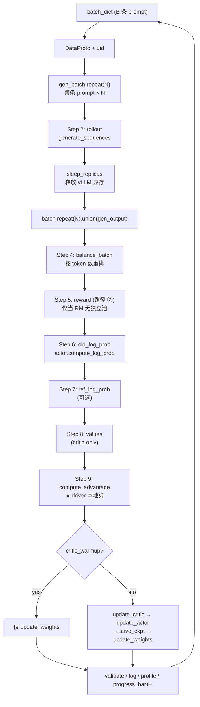

---

## 十二、核心算法实现速览

### 11.1 Advantage 估计（`core_algos.py`）

`@register_adv_est` 注册器支持多种优势估计：

| 算法 | 是否需要 critic | 公式核心 |
|---|---|---|
| **GAE** (PPO) | 是 | $\delta_t = r_t + \gamma V(s_{t+1}) - V(s_t)$，$A_t = \delta_t + \gamma\lambda A_{t+1}$ |
| **GRPO** | 否 | 同一 prompt 的 N 个 response 算 group reward 的 z-score |
| **RLOO** | 否 | leave-one-out baseline |
| **REINFORCE++** | 否 | 简单标准化的 reward |
| **REMAX** | 否 | 用贪心解作为 baseline |

GRPO 实现（`core_algos.py:268`）：

```python
@register_adv_est(AdvantageEstimator.GRPO)
def compute_grpo_outcome_advantage(token_level_rewards, response_mask, index, ...):
    scores = token_level_rewards.sum(dim=-1)              # 每个 response 总 reward
    id2score = defaultdict(list)
    for i in range(bsz):
        id2score[index[i]].append(scores[i])              # 按 prompt uid 分组
    for idx in id2score:
        id2mean[idx] = torch.mean(...)
        id2std[idx]  = torch.std(...)
    # advantage = (score - group_mean) / group_std
```

### 11.2 PPO 策略损失（`core_algos.py:1279`）

```python
ratio = torch.exp(log_prob - old_log_prob)               # π_θ / π_old
pg_losses1 = -advantages * ratio
pg_losses2 = -advantages * torch.clamp(ratio, 1 - clip_low, 1 + clip_high)
pg_losses  = torch.maximum(pg_losses1, pg_losses2)       # PPO clip
# 还支持 dual-clip：当 advantage<0 时再用 clip_ratio_c 做下界裁剪
pg_loss = agg_loss(pg_losses, response_mask, loss_agg_mode)
```

---

## 十三、典型调用栈与运行时调用追踪

### 12.1 `actor_rollout_wg.update_actor(batch)` 完整调用栈

```
RayPPOTrainer.fit()
  └─ self.actor_rollout_wg.update_actor(batch)
       └─ [Ray RPC, dispatch=DP_COMPUTE_PROTO]
            └─ ActorRolloutRefWorker.update_actor()            # workers/engine_workers.py:649
                 └─ self.actor.train_mini_batch(data)
                      └─ TrainingWorker.train_mini_batch()     # workers/engine_workers.py:239
                           └─ self.engine.train_step(...)      # workers/engine/fsdp/...
                                └─ loss_fn = policy_loss       # core_algos.compute_policy_loss
                                └─ loss.backward(); optim.step()
```

### 12.2 `actor_rollout_wg.compute_log_prob(batch)` 运行时追踪

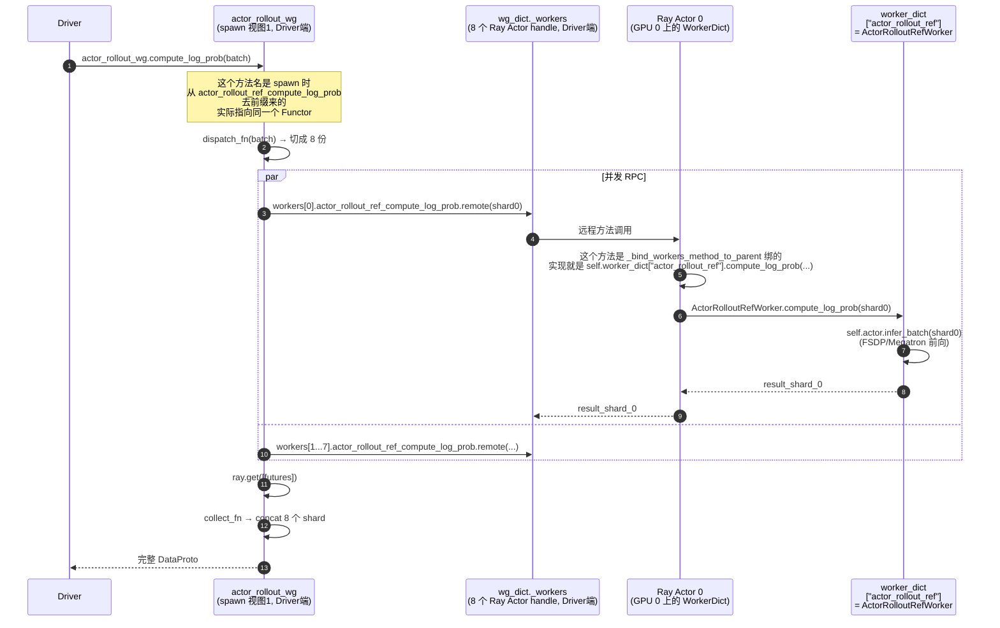

注意第 4 步：driver 上调的是去前缀的 `compute_log_prob`，但 RPC 到 Ray Actor 时传过去的方法名是带前缀的 `actor_rollout_ref_compute_log_prob`。这样 Ray Actor（`WorkerDict`）才能正确路由到内部的 `worker_dict["actor_rollout_ref"]`。

---

## 十四、`main_ppo.py` vs `main_ppo_sync.py`：双训练入口对照

verl 仓库里有两个长得很像的入口：

- `verl/trainer/main_ppo.py` → 走 `RayPPOTrainer`（`verl/trainer/ppo/ray_trainer.py`），**主线、默认入口**
- `verl/trainer/main_ppo_sync.py` → 内部自带 `PPOTrainer` 类（不继承 `RayPPOTrainer`），**TransferQueue + ReplayBuffer 异步实验性入口**

它们 `fit()` 看起来几乎一样：
```python
combined_gen_output = self.async_rollout_manager.generate_sequences(combined_gen_batch)
batch = self._compute_old_log_prob(batch, ...)
batch = self._compute_ref_log_prob(batch, ...)
batch = self._update_actor(batch, ...)
```
但**底下是两条完全不同的数据通路**。初学时很容易误以为"一份代码自适应两种模式"——其实不是。

### 14.1 关键差异一览

| 维度 | `main_ppo.py` | `main_ppo_sync.py` |
|---|---|---|
| Trainer 类 | `RayPPOTrainer`（`ppo/ray_trainer.py`） | `PPOTrainer`（自身定义，**不继承**） |
| `async_rollout_manager` 实际类型 | `AgentLoopManager` | `AgentLoopManagerTQ`（子类覆写） |
| `generate_sequences` 返回值 | `DataProto`（真数据） | **`None`**（fire-and-forget） |
| 训练流水线的 `batch` 是什么 | `DataProto`（含张量） | `KVBatchMeta`（只含 `keys` / `partition_id` / `tags`） |
| 真实数据载体 | driver 本地内存 | **TransferQueue（远端分布式 KV 存储）** |
| 同名方法（`_compute_old_log_prob` 等） | 直接对张量操作并返回 DataProto | `tq.kv_batch_get → 计算 → tq.kv_batch_put`，返回 meta |
| `actor_rollout_wg.compute_log_prob` 等 Worker 端方法 | 收发 `DataProto` | 收发 `KVBatchMeta`，**业务方法体不变** |

### 14.2 同一个名字、两套实现 —— driver 层是"独立平行实现"

证据 1：`main_ppo_sync.PPOTrainer` **没有继承** `RayPPOTrainer`：
```python
# verl/trainer/main_ppo_sync.py
from verl.trainer.ppo.ray_trainer import apply_kl_penalty, compute_advantage   # ★ 只 import 了两个算法函数
...
class PPOTrainer:                              # ★ 没有父类！
    """PPO Trainer with TransferQueue and ReplayBuffer."""
```

证据 2：同名方法签名都不一样（`batch` 类型 + 多了 `metrics` 参数）：

| 方法 | `RayPPOTrainer`（ray_trainer.py） | `PPOTrainer`（main_ppo_sync.py） |
|---|---|---|
| `_balance_batch` | `(DataProto, metrics)` → 原地改 | `(KVBatchMeta, metrics)` → `KVBatchMeta` |
| `_compute_old_log_prob` | `(DataProto)` → `(DataProto, mfu)` | `(KVBatchMeta, metrics)` → `KVBatchMeta` |
| `_compute_ref_log_prob` | `(DataProto)` → `DataProto` | `(KVBatchMeta, metrics)` → `KVBatchMeta` |
| `_compute_values` | `(DataProto)` → `DataProto` | `(KVBatchMeta, metrics)` → `KVBatchMeta` |
| `_compute_advantage` | fit 内 inline 调 `compute_advantage` | `(KVBatchMeta, metrics)` → `KVBatchMeta` |
| `_update_actor` / `_update_critic` | `(DataProto)` → `DataProto` | `(KVBatchMeta, metrics)` → `KVBatchMeta` |
| `_log_rollout_data` | `(DataProto, extra, ...)` | `(KVBatchMeta, ...)` |
| `_add_remax_reward_baselines` | （不存在） | `(KVBatchMeta)` → `KVBatchMeta`（新增） |

同名只是**契约对齐**，方法体走的是两条范式：

```python
# RayPPOTrainer._compute_old_log_prob（ray_trainer.py）—— DataProto 范式
batch_td = batch.to_tensordict()                                # 直接拿张量
output = self.actor_rollout_wg.compute_log_prob(batch_td)
entropy = tu.get(output, "entropy")                              # 直接拿返回值
log_probs = tu.get(output, "log_probs")
...
return old_log_prob, old_log_prob_mfu                            # 返回真数据

# PPOTrainer._compute_old_log_prob（main_ppo_sync.py）—— TQ 范式
batch.extra_info.update({"calculate_entropy": True, ...})        # batch 只是 meta
output: KVBatchMeta = self.actor_rollout_wg.compute_log_prob(batch)
data = tq.kv_batch_get(keys=batch.keys, partition_id=batch.partition_id,
                       select_fields=["entropy", "log_probs", "response_mask"])
data["old_log_probs"] = response_from_nested(data.pop("log_probs"), data["response_mask"])
batch = tq.kv_batch_put(keys=batch.keys, partition_id=batch.partition_id,
                        fields=data.select("old_log_probs", "entropy"))
return batch                                                     # 返回 meta
```

> **driver 层结论**：`main_ppo_sync.py` 几乎重写了整条 PPOTrainer 流水线（这也是该文件超过 1700 行的原因），同名方法只是为了让读者看着熟悉。

### 14.3 fire-and-forget 的 `generate_sequences`

普通模式（同步收集）：
```python
# verl/experimental/agent_loop/agent_loop.py: AgentLoopManager.generate_sequences
async def generate_sequences(self, prompts: DataProto) -> DataProto:
    chunkes = prompts.chunk(len(self.agent_loop_workers))
    outputs = await asyncio.gather(*[w.generate_sequences.remote(c) for w, c in zip(...)])
    output = DataProto.concat(outputs)
    return output                                  # ★ 拼接后返回完整数据
```

TQ 模式（fire-and-forget）：
```python
# verl/trainer/main_ppo_sync.py: AgentLoopManagerTQ.generate_sequences
def generate_sequences(self, prompts: TensorDict) -> None:        # ★ 返回 None
    items = {uid: {"global_steps": ..., "status": "running"} ...}
    self.replay_buffer.add(partition_id, items)                   # 1. ReplayBuffer 标记 pending
    chunkes = prompts.chunk(len(self.agent_loop_workers))
    ray.get([w.generate_sequences.remote(c) for w, c in zip(...)])# 2. 派发任务后立即返回

# Worker 端也是 fire-and-forget（AgentLoopWorkerTQ.generate_sequences）
async def generate_sequences(self, batch: TensorDict) -> None:
    for i in range(len(batch)):
        task = asyncio.create_task(self._run_prompt(...))         # 不 await
        self.background_tasks.add(task)
# 每条轨迹完成后写 TQ：
await tq.async_kv_put(key=uid, partition_id=partition_id, tag={"status": "finished"})
```

对应 driver 调用现场对比：
```python
# main_ppo.py（接住返回值）
combined_gen_output = self.async_rollout_manager.generate_sequences(combined_gen_batch)
batch = batch.union(combined_gen_output)

# main_ppo_sync.py（丢弃返回值，从 ReplayBuffer 阻塞捞）
self.async_rollout_manager.generate_sequences(batch)              # batch 写入了 TQ
batch = self.replay_buffer.sample(partition_id="train", ...)      # 阻塞等就绪
```

`ReplayBuffer` 通过后台线程 `_subscriber_thread` 周期轮询 TQ 的 `kv_list()`，把状态变为 `finished` 的 uid 移入就绪队列，供 `sample()` 取用。

### 14.4 灵魂之问：Worker 端方法要不要也写两份？答案是 **不要**

driver 是两套独立实现，但 **Worker 端方法（`compute_log_prob` / `update_actor` / `compute_ref_log_prob` …）只有一份代码**。同一份 `ActorRolloutRefWorker.compute_log_prob`，普通模式下吃 `DataProto` 吐 `DataProto`，TQ 模式下吃 `KVBatchMeta` 吐 `KVBatchMeta`。

**真正实现"自适应"的是 `tqbridge` 装饰器**——它由 `@register` 自动套在每个 Worker 端业务方法外层：

```python
# verl/single_controller/base/decorator.py: register()
def decorator(func):
    func = tqbridge(dispatch_mode=dispatch_mode)(func)   # ★ 关键
    @wraps(func)
    def inner(*args, **kwargs): ...
```

> Worker 端业务方法因此**永远不感知 TransferQueue 的存在**，它写的是普通 TensorDict in/out 的代码。

### 14.5 `tqbridge` 做了什么（核心解读）

源文件：`verl/utils/transferqueue_utils.py`。

**一句话**：`tqbridge` 是 Worker 端业务方法外面的一层"门卫"，自动完成 **`meta → 真数据 → 业务计算 → 真数据 → meta`** 的双向桥接。

工作流（同步版 `inner` / 异步版 `async_inner` 同构）：

```python
def inner(*args, **kwargs):
    # 1. 在所有入参里扫描是否有 BatchMeta / KVBatchMeta
    batch_meta = _find_meta(*args, **kwargs)
    if batch_meta is None:
        return func(*args, **kwargs)        # ★ 没 meta —— 跑普通 DataProto 路径，零开销

    # 2. KVBatchMeta 先归一化成 BatchMeta（统一后续处理）
    if isinstance(batch_meta, KVBatchMeta):
        tags = batch_meta.tags
        batch_meta = kv_batch_meta2batch_meta(batch_meta)

    # 3. 把每个 meta 入参替换成从 TQ 取回的真数据 TensorDict
    args = [_meta_to_realdata(a) if isinstance(a, BatchMeta | KVBatchMeta) else a for a in args]
    kwargs = {k: _meta_to_realdata(v) if isinstance(v, ...) else v for k, v in kwargs.items()}

    # 4. 执行原业务函数（拿到的就是普通 TensorDict）
    output = func(*args, **kwargs)

    # 5. 决定要不要把 output 写回 TQ
    put_data = isinstance(output, TensorDict) and bool(output.batch_size)
    need_collect = _compute_need_collect(dispatch_mode, args)    # 分布式优化：仅指定 rank 写

    if put_data and need_collect:
        updated_meta = _update_meta_with_output(output, batch_meta, func.__name__)
        if is_kv_batch_meta:
            updated_meta = batch_meta2kv_batch_meta(updated_meta)
            updated_meta.tags = tags
        return updated_meta                  # ★ 返回更新过 fields 的 meta，driver 拿到的是 meta
    return _postprocess_common(output, put_data, need_collect)   # 非 TensorDict 输出 / 不需要写
```

异步函数走 `async_inner`，逻辑同构（区别只是 `await func(...)`、`_async_meta_to_realdata`、`async_batch_meta2kv_batch_meta`）。最后通过 `inspect.iscoroutinefunction` 自动二选一：
```python
wrapper = wrapper_async_inner if inspect.iscoroutinefunction(func) else wrapper_inner
return wrapper
```

#### 三个关键工具函数

| 函数 | 角色 |
|---|---|
| `_find_meta(*args, **kwargs)` | 在所有位置/关键字参数中找出第一个 `BatchMeta`/`KVBatchMeta` 实例；找不到代表"非 TQ 模式"，直接走原函数 |
| `_meta_to_realdata(meta)` | 调 `tq_client.async_get_data(meta)`，从 TransferQueue 把张量取回，组成 TensorDict；附带把 `meta.extra_info` 合并进去 |
| `_update_meta_with_output(output, meta)` | 把 output 中的 tensor 字段 `tq_client.async_put(...)` 写回 TQ；non-tensor 字段保留在 `meta.extra_info` 里 |

#### `BatchMeta` ↔ `KVBatchMeta` 双向转换

```python
async_kv_batch_meta2batch_meta()   # KV(keys + partition) → 全局 indexes
async_batch_meta2kv_batch_meta()   # 全局 indexes → KV(keys + partition)
```

为什么要两种 meta？
- `BatchMeta`（基于 `global_indexes`）是 TQ 的标准内部表示，按 index 取数效率最高
- `KVBatchMeta`（基于 `keys + partition_id`）面向上层使用，更直观（一个 prompt 一个 uid）

driver 看到的、业务方法签名上声明的，几乎都是 `KVBatchMeta`；`tqbridge` 内部统一转 `BatchMeta` 做 IO，最后再转回 `KVBatchMeta` 返回，保持上层接口一致。

#### 三种执行场景下 tqbridge 的行为

| 场景 | 入参里有 meta? | tqbridge 行为 |
|---|---|---|
| `main_ppo.py` 普通模式 | ❌（传的是 DataProto） | 直接跑原函数，**零开销** |
| `main_ppo_sync.py` TQ 模式 | ✅（传 KVBatchMeta） | meta → TQ.get → 真数据 → 业务函数 → TQ.put → meta |
| 仅读不写（如某些 reduce 操作） | ✅ 但 `output` 不是 TensorDict | 只做 get，不做 put，返回原 output |

#### 不写 ↔ 写的判定

```python
put_data = isinstance(output, TensorDict) and bool(output.batch_size)
```

业务方法只要**返回值不是 TensorDict**（比如返回纯 dict 的指标、纯标量），tqbridge 就不会把它写回 TQ，行为类似一个只读 RPC。

#### "fail-open" 的容错设计

文件顶部的 import：
```python
try:
    import transfer_queue as tq
    from transfer_queue import BatchMeta, KVBatchMeta
except ImportError:
    class BatchMeta: pass
    class KVBatchMeta: pass
    tq = _MockTQ()        # 任何 tq.xxx() 调用 → RuntimeError
```

未装 `TransferQueue` 包的用户：
- `_find_meta` 永远返回 `None`（因为没人传得出 BatchMeta 实例）
- `tqbridge` 立刻 `return func(*args, **kwargs)`
- **跟没装饰一样，零负担**

这就是为什么 `@register` 可以放心地在 *每一个* Worker 方法外层无脑套上 `tqbridge`。

### 14.6 两层"自适应"的精确分工

```
┌─────────────────────────────────────────────────────────────┐
│  Driver 层（PPOTrainer / RayPPOTrainer）                    │
│   ❌ 不自适应：两份独立实现，同名但内部范式完全不同         │
│   ✅ 工作产出：driver 决定数据是 DataProto 还是 KVBatchMeta │
└──────────────┬──────────────────────────────────────────────┘
               │ Ray RPC（传 DataProto）
               │ 或 RPC（传 KVBatchMeta，张量在 TQ 里）
               ▼
┌─────────────────────────────────────────────────────────────┐
│  Worker 层（ActorRolloutRefWorker.compute_log_prob 等）     │
│   @register(dispatch_mode=...)                              │
│   @tqbridge   ←── 自动 meta↔realdata 桥接，业务方法只写一份│
│   def compute_log_prob(batch):                              │
│       # 不管来源是哪种 meta / DataProto，                   │
│       # 这里拿到的永远是 TensorDict                         │
└─────────────────────────────────────────────────────────────┘
```

### 14.7 何时选哪个入口

| 场景 | 推荐 |
|---|---|
| 学习 verl 主线、读 PPO/GRPO 教科书式实现 | **`main_ppo.py`**（默认） |
| 生产复现论文、跑 examples 里的脚本 | **`main_ppo.py`** |
| 多机大集群、rollout 极慢且与训练严重错峰、需要异步训推流水线 | `main_ppo_sync.py` |
| 想用 ReplayBuffer / TransferQueue 做 off-policy 实验 | `main_ppo_sync.py` |

> 一般情况下，**学习和上手以 `main_ppo.py` 为准**；`main_ppo_sync.py` 是 verl 团队在探索更激进的异步训练拓扑的实验地，理解它需要先把主线吃透。

### 14.8 一句话总结

> verl 的"两个训练入口"不是"一份代码两种模式"，而是**两份 driver 实现 + 一份 Worker 实现**：driver 通过独立的同名平行类完成调度差异；Worker 通过 `@register` 自带的 `tqbridge` 装饰器，让业务方法对 TransferQueue **完全无感**——这才是 verl 能优雅承载两种范式的核心秘密。

---

## 十五、学习路径与扩展方向

### 15.1 推荐学习顺序

按这个顺序读，一两天就能掌握主线：

1. **`verl/trainer/main_ppo.py`** — 入口，全图鸟瞰
2. **`verl/trainer/ppo/ray_trainer.py`** 中的 `fit()` 与 `init_workers()` — 核心训练循环
3. **`verl/trainer/ppo/core_algos.py`** — 纯算法（看懂就懂了 PPO/GRPO 数学）
4. **`verl/single_controller/base/decorator.py`** — 理解 dispatch 模式
5. **`verl/single_controller/base/worker_group.py`** 的 `_bind_worker_method` — 元编程关键
6. **`verl/single_controller/ray/base.py`**：
   - `RayClassWithInitArgs.__call__`
   - `create_colocated_worker_cls`
   - `RayWorkerGroup.__init__` / `_create_worker`
   - `func_generator`
   - `spawn` / `_rebind_actor_methods`
7. **`verl/workers/engine_workers.py`** 的 `ActorRolloutRefWorker` — 三身份实现
8. **`verl/protocol.py`** — `DataProto` 设计
9. 跑一个完整例子：`examples/ppo_trainer/run_qwen2-7b_seq_balance.sh` + 对应 yaml

### 15.2 各层抽象的设计权衡

| 层 | 不要这层会怎样 | 这层带来的好处 |
|---|---|---|
| `RayClassWithInitArgs` | driver 必须在创建时就定 placement group | **延迟实例化**，让 placement group 创建与 worker 实例化解耦 |
| `WorkerDict` 动态生成 | 每种 colocate 组合都要写一个新类 | **运行时按需组合**，支持任意 role 组合 colocate |
| 方法名加前缀 + spawn 拆视图 | 必须给 driver 暴露 `xxx_yyy_method` | **driver 代码保持优雅**：`critic_wg.train_mini_batch()` |
| `@register` + dispatch fn | driver 要手动切 batch、做 ray.get、concat | **声明式 RPC**：算法工程师不需要懂分布式 |
| `ActorRolloutRefWorker` 三身份 | 三种 worker 各占 GPU，资源浪费 3 倍 | **HybridEngine**：同一组 GPU 复用，是 verl 论文的核心贡献 |

### 15.3 可继续深入的方向

- **Agentic RL（multi-turn / tool calling）**：`verl/experimental/agent_loop/`，异步 rollout + tool 注册
- **算法扩展**：自定义 advantage / policy loss（通过 `@register_adv_est` / `@register_policy_loss`）
- **后端工程**：Megatron + vLLM 之间如何 reshard 权重（`verl/checkpoint_engine/`）
- **异步训练**：`verl/experimental/fully_async_policy/`、`one_step_off_policy/`
- **`make_nd_compute_dataproto_dispatch_fn`**：基于 device mesh 的 nd 切分如何实现

### 15.4 关键要点回顾

| 维度 | 关键点 |
|---|---|
| **设计哲学** | Hybrid Controller：单驱动 + RPC 编排，算法代码像单机一样写 |
| **核心抽象** | `Role` → `Worker` → `WorkerGroup` → `RayWorkerGroup` |
| **数据载体** | `DataProto`（TensorDict + non-tensor + meta） |
| **训练-推理切换** | HybridEngine：sleep/wake + CheckpointEngine 同步权重 |
| **算法解耦** | `core_algos.py` 是纯函数注册表，新增算法只需写函数 + `@register_adv_est` |
| **后端可插拔** | training: `fsdp/fsdp2/megatron/torchtitan`；rollout: `vllm/sglang/trtllm` |
| **完整数据流** | `rollout → reward → old_logp → ref_logp → values → adv → update_critic → update_actor → sync_weights` |
| **两层组合** | 业务层（`ActorRolloutRefWorker` 内部 3 子对象，共享权重） + 框架层（`WorkerDict` 把不同 Worker 类塞进同一 Ray Actor） |
| **视图机制** | `spawn` 是纯 Driver 端操作：多视图复用同一组 `ActorHandle`，仅去前缀重绑方法别名 |
| **双训练入口** | `main_ppo.py`（DataProto 主线）与 `main_ppo_sync.py`（TransferQueue 实验线）是两份独立 driver 实现；Worker 端业务方法只写一份，靠 `@register` 自带的 `tqbridge` 装饰器自动完成 `meta ↔ realdata` 桥接 |

---

## 十六、多机训练与分布式启动机制（Ray + PyTorch 协同）

> 这一章解决一个非常容易踩坑的问题：**verl 不用 `torchrun`，那 N 张 GPU 是怎么被组织成一个分布式训练集群的？**
>
> 核心一句话：**Ray 负责"空间分配"（哪些进程跑在哪些 GPU 上），`torch.distributed.init_process_group` 负责"通信建立"（这些进程之间怎么对话）。**

### 16.1 verl 多机训练全景图

以 **2 节点 × 8 GPU = 16 卡** 默认 PPO 配置为例：

```
配置层：trainer.nnodes=2, trainer.n_gpus_per_node=8
        │
        ▼
1) 启动 Ray 集群（用户操作）
   Node A: ray start --head --port=6379 --num-gpus=8
   Node B: ray start --address='NodeA_IP:6379' --num-gpus=8
        │
        ▼
2) Driver 提交：python -m verl.trainer.main_ppo trainer.nnodes=2 ...
   (或 ray job submit ...)
        │
        ▼
3) ResourcePoolManager 申请 PlacementGroup
   resource_pool_spec = {"global_pool": [8, 8]}      # nnodes=2 → 2 个 PG
   每个 PG 含 8 个 bundle，每 bundle = {"CPU": k, "GPU": 1}
   strategy="STRICT_PACK" → 每个 PG 全部 bundle 必须落在同一台机器
        │
        ▼
4) 取 PG_0 的 bundle 0 所在节点的 IP/free port
   → MASTER_ADDR = NodeA_IP, MASTER_PORT = 43891
        │
        ▼
5) 创建 16 个 Ray actor
   - 用 placement_group_bundle_idx=local_rank 把 actor 绑到具体 GPU
   - 通过 runtime_env.env_vars 注入 RANK / WORLD_SIZE / MASTER_ADDR / MASTER_PORT
        │
        ▼
6) actor 进程启动 → Worker.__init__ 把 env 写回 os.environ
   (此时 PyTorch 分布式还没初始化)
        │
        ▼
7) 业务代码 TrainingWorker.__init__ 调
   initialize_global_process_group_ray()
     └─ if not torch.distributed.is_initialized():
          torch.distributed.init_process_group(backend="nccl", ...)
   → 16 ranks 在 MASTER_ADDR:MASTER_PORT 上 rendezvous，组成 NCCL 通信组
        │
        ▼
8) 在全局 PG 之上派生子组：
   - init_device_mesh(...)       → (dp, tp, pp) mesh
   - FSDP shard group / Megatron TP-PP-DP group / vLLM infer_tp group
        │
        ▼
9) 训练正常运行（NCCL 走 NVLink/IB；控制面走 Ray RPC）
```

### 16.2 Ray Placement Group / Bundle 在 verl 中的具体形态

源码 `verl/single_controller/ray/base.py:143-160`：

```python
bundle = {"CPU": self.max_colocate_count}     # CPU 配额
if self.use_gpu:
    bundle[device_name] = 1                   # 每个 bundle 锁 1 张 GPU
pg_scheme = [[bundle.copy() for _ in range(process_count)]
             for process_count in self._store]  # _store = [8, 8]
pgs = [placement_group(bundles=bundles, strategy=strategy, ...)
       for bundles in pg_scheme]
ray.get([pg.ready() for pg in pgs])           # gang scheduling
```

| 层 | 数量 | 含义 | 在 2×8 例子里 |
|---|---|---|---|
| **Bundle** | 16 | "1 张 GPU + 若干 CPU" 的资源占位 | 每张 GPU 一个 bundle |
| **PlacementGroup** | 2 | 一组 bundle + 放置策略 | 每台节点一个 PG，STRICT_PACK 锁同机 |
| **Ray actor** | 16 | Python 进程 | 每张 GPU 一个 actor，每个 actor 是一个独立 OS 进程 |

**关键设计**：`STRICT_PACK` 保证一个 PG 的 bundle 全在同一节点 ⇒ 一个 PG 自然对应一台机器；这就是为什么 `len(pgs) == nnodes`。详见 [`ray_notes.md` §3](./ray_notes.md#3-placement-group--bundle)。

### 16.3 `num_gpus = 1 / max_colocate_count` 的真实含义

源码 `_create_worker`：

```python
num_gpus = 1 / resource_pool.max_colocate_count   # 默认 1/3
worker = ray_cls_with_init(
    placement_group=pg,
    placement_group_bundle_idx=local_rank,
    num_gpus=num_gpus,                            # ★
    ...
)
```

要点：

1. **它不是"只用 1/3 张 GPU"**——这是 Ray 的逻辑资源记账，不限制实际 CUDA 显存/算力
2. **它的作用是允许同一张 GPU 的 bundle 被多个 actor 共占**（colocate）
3. **它配合 hybrid worker 使用**：
   - `ActorRolloutRefWorker` 是**单进程内**承载 actor / ref / rollout 三对象（业务层组合）
   - 同时它又可以与 `Critic` 等其它 WorkerGroup colocate 同卡（框架层组合，靠 `WorkerDict` 实现）
   - `1/k` 是给"多种 WorkerGroup 共置"留的余量

### 16.4 `MASTER_ADDR / MASTER_PORT` 是怎么定下来的

`verl/single_controller/ray/base.py:518-534`：

```python
def _get_master_addr_port(self, pg, bundle_index=0, master_port_range=None):
    if self._master_addr is None and self._master_port is None:
        self._master_addr, self._master_port = ray.get(
            get_master_addr_port.options(
                scheduling_strategy=PlacementGroupSchedulingStrategy(
                    placement_group=pg,
                    placement_group_bundle_idx=bundle_index    # 默认 0
                ),
            ).remote(master_port_range=master_port_range)
        )
```

driver 把一个临时函数 `get_master_addr_port` **调度到 PG_0 的 bundle 0 上跑**（即 rank 0 将要落到的那张 GPU 所在节点），让它返回**本机 IP + 一个空闲端口**——这就成为整个 WorkerGroup 共享的 master 信息。

**好处**：用户不用手动指定 master，rank 0 在哪台机器、master_addr 就是哪台。Ray 调度的稳定性（`sort_placement_group_by_node_ip`）确保 rank 0 落点可复现。

### 16.5 环境变量注入：Ray 替代 torchrun

`_create_worker` 注入的环境变量：

```python
env_vars = {
    "WORLD_SIZE": str(world_size),       # = 16
    "RANK": str(rank),                   # = 0..15
    "WG_PREFIX": self.name_prefix,
    "WG_BACKEND": "ray",
    "RAY_LOCAL_WORLD_SIZE": str(local_world_size),  # = 8
    "MASTER_ADDR": self._master_addr,
    "MASTER_PORT": self._master_port,
}
ray_cls_with_init.update_options({"runtime_env": {"env_vars": env_vars}, ...})
```

对比 `torchrun`：

| 责任 | torchrun | verl + Ray |
|---|---|---|
| 拉起 N 个进程 | torchrun 在每节点 fork | Ray 按 placement group 创建 actor |
| 注入 `RANK / WORLD_SIZE` | torchrun 自动 | `runtime_env.env_vars` 注入 |
| `MASTER_ADDR / PORT` | rdvz / 用户指定 | 在 PG_0 bundle 0 上动态选 |
| 进程绑卡 | `LOCAL_RANK` + `CUDA_VISIBLE_DEVICES` | placement_group_bundle_idx + Ray 自动设 `CUDA_VISIBLE_DEVICES` |
| 进程同机 / 跨机 | `--nnodes` / `--node-rank` | placement group `STRICT_PACK` |

### 16.6 `init_process_group` 的精确触发链路

很多人初读会问："`Worker.__init__` 里没有 `if not torch.distributed.is_initialized():` 啊？" 答案是 **`Worker` 基类故意保持中立，由业务子类自己决定何时调用**。

#### 16.6.1 `Worker.__init__` 只做"摆好餐桌"

`verl/single_controller/base/worker.py:181-216`：

```python
def __init__(self, cuda_visible_devices=None) -> None:
    self._setup_env_cuda_visible_devices()

    world_size = int(os.environ["WORLD_SIZE"])
    rank = int(os.environ["RANK"])
    self._rank = rank
    self._world_size = world_size

    master_addr = os.environ["MASTER_ADDR"]
    master_port = os.environ["MASTER_PORT"]
    local_world_size = int(os.getenv("LOCAL_WORLD_SIZE", "1"))
    local_rank = int(os.getenv("LOCAL_RANK", "0"))

    store = {...}
    self._configure_with_store(store=store)   # 把变量再写回 os.environ
```

**它只读环境变量、写回 os.environ，不做 init_process_group**。

为什么这样设计？因为：
- 不同 worker 后端不同（FSDP/Megatron 用 nccl，sglang 协调用 gloo）
- 有些 worker 根本不需要分布式（纯 CPU reward worker、调外部 API）
- 让基类保持中立，业务子类按需调用工具函数

#### 16.6.2 真正调用 `init_process_group` 的位置

| 位置 | 作用 |
|---|---|
| `verl/utils/distributed.py:86-97` (`initialize_global_process_group_ray`) | 通用工具函数，含 `if not torch.distributed.is_initialized():` 守卫 |
| `verl/workers/engine_workers.py:93` (`TrainingWorker.__init__`) | **PPO 主路径**：actor / critic / ref worker 起步时调它建立全局 nccl PG |
| `verl/checkpoint_engine/base.py:298` | rollout 侧建 cpu:gloo PG（sglang/trtllm 内部协调用） |
| `verl/checkpoint_engine/{nccl,hccl,kimi,nixl,mooncake}_checkpoint_engine.py` | 训练↔推理权重同步专用 PG |
| `verl/trainer/sft_trainer.py:451` | SFT 入口（torchrun 模式） |
| `verl/model_merger/megatron_model_merger.py` / `scripts/converter_hf_to_mcore.py` | 离线工具 |

工具函数实现（`verl/utils/distributed.py`）：

```python
def initialize_global_process_group_ray(timeout_second=36000, backend=None):
    if backend is None:
        backend = get_nccl_backend()
    if not torch.distributed.is_initialized():     # ★ 你之前没找到的就在这里
        rank = int(os.environ.get("RANK", 0))
        world_size = int(os.environ.get("WORLD_SIZE", 1))
        torch.distributed.init_process_group(
            backend=backend, rank=rank, world_size=world_size,
            timeout=timeout, init_method=os.environ.get("DIST_INIT_METHOD", None),
        )
```

业务侧的调用（`verl/workers/engine_workers.py`）：

```python
class TrainingWorker(Worker, DistProfilerExtension):
    def __init__(self, config):
        ...
        initialize_global_process_group_ray(timeout_second=None)   # ★
        set_numa_affinity()
        ...
```

#### 16.6.3 为什么基类不调，业务子类才调？

```
single_controller/base/worker.py    ← 调度框架，对后端无感（中立）
   Worker.__init__: 只读 env, 写回 os.environ

verl/utils/distributed.py            ← 工具函数（含 is_initialized 守卫）
   initialize_global_process_group_ray()

verl/workers/engine_workers.py       ← 业务 worker（知道自己要什么 backend）
   TrainingWorker.__init__: 调 initialize_global_process_group_ray()

verl/checkpoint_engine/base.py       ← rollout worker（知道自己用 gloo）
   调 initialize_global_process_group_ray(backend="cpu:gloo")
```

**这种"调度层只准备元数据、业务层决定何时初始化"的分层**，正是 verl 比 torchrun 更灵活的关键——不同 worker 可以有不同的 backend 选择，互不干扰。

### 16.7 训练时同时存在的多个 process group

verl 在跑训练时**并不只有一个 nccl PG**，而是同时维护多个 PG，各管一摊：

| Process Group | rank 范围 | backend | 用途 |
|---|---|---|---|
| **训练主 PG** | 训练侧 16 ranks | nccl | FSDP / Megatron 全局通信，all-reduce 梯度 |
| **rollout cpu PG** | rollout 侧 ranks | cpu:gloo | sglang / trtllm 内部信号同步 |
| **vLLM infer_tp PG** | 每个 rollout replica 内部 | nccl | TP 间张量切分通信 |
| **CheckpointEngine PG** | 训练 ranks + rollout ranks | nccl / nixl / mooncake | actor → rollout 权重同步专用 |

在 `init_device_mesh(get_device_name(), mesh_shape=(dp, tp, pp))` 之上还会派生出更多子组（DP / TP / PP / CP 各一组）。所有这些子组都依附在第 6.6 节里 `TrainingWorker.__init__` 建好的训练主 PG 之上。

### 16.8 用户操作清单：2 节点开训最小步骤

假设两台机器 `192.168.1.10`（Head）和 `192.168.1.11`（Worker），每台 8 卡 H100，已装好 verl + Docker。

**Step 1：环境一致性**（两台机器都做）
- 同一份镜像（`verlai/verl:base-...`）
- 同一份 verl 代码 / 数据 / 模型权重路径
- NCCL 网络变量（`NCCL_IB_HCA`、`NCCL_SOCKET_IFNAME` 等按集群配）

**Step 2：起 Ray 集群**

```bash
# Head (192.168.1.10)
ray start --head \
    --node-ip-address=192.168.1.10 \
    --port=6379 \
    --dashboard-host=0.0.0.0 \
    --dashboard-port=8265 \
    --num-gpus=8

# Worker (192.168.1.11)
ray start --address='192.168.1.10:6379' --num-gpus=8

# 任一节点验证
ray status   # 期望：2 nodes, 16 GPUs
```

**Step 3：提交训练**

```bash
# 在 Head 上
python3 -m verl.trainer.main_ppo \
    trainer.nnodes=2 \
    trainer.n_gpus_per_node=8 \
    actor_rollout_ref.rollout.tensor_model_parallel_size=2 \
    ...
```

或用 `ray job submit --address="http://192.168.1.10:8265" --runtime-env=verl/trainer/runtime_env.yaml -- python3 -m verl.trainer.main_ppo ...`，好处是日志/状态可在 dashboard 查看。

**Step 4：清理**

```bash
# 两台机器各自
ray stop
```

更详细的多机部署方式（SkyPilot / Slurm / dstack / AMD）见 `docs/start/multinode.rst`。

### 16.9 调试指南：分布式启动出问题怎么查

| 症状 | 可能原因 | 排查 |
|---|---|---|
| actor 卡在 `placement_group(...).ready()` | Ray 集群资源不够（nnodes 写大了 / GPU 申报少了） | `ray status` 看资源；检查 `--num-gpus` 与 `trainer.n_gpus_per_node` 一致 |
| `init_process_group` 超时 | NCCL 网络不通 / `MASTER_PORT` 被防火墙拦 | `NCCL_DEBUG=INFO` 看日志；`telnet MASTER_ADDR MASTER_PORT` 验证 |
| rank 0 卡在 rendezvous 但 rank 1+ 没动 | 节点间 IP 不互通 / `runtime_env` 环境变量没注入 | actor 内 `print(os.environ['MASTER_ADDR'])` 验证 |
| `CUDA out of memory` 在 rollout 阶段 | 没正确 `sleep_replicas` / colocate 配置不对 | 看 `aggressive_empty_cache` 是否被调；检查 `max_colocate_count` |
| 跨节点 NCCL 慢 | NCCL 走了错的网卡 | 设 `NCCL_SOCKET_IFNAME=eth0`、`NCCL_IB_HCA=mlx5_0,...` |

### 16.10 一句话总结

> verl 多机训练 = **「一个 Ray 集群」+「`trainer.nnodes` / `trainer.n_gpus_per_node` 两个参数」**。
>
> Ray 用 placement group 把 actor 进程精确摆到每张 GPU；通过 `runtime_env.env_vars` 注入 `RANK / WORLD_SIZE / MASTER_ADDR / MASTER_PORT`；业务 worker 在自己的 `__init__` 里调 `initialize_global_process_group_ray()`，触发 PyTorch 的 `if not is_initialized(): init_process_group(nccl)`，建立全局通信组。
>
> 不需要 `torchrun`，但每个进程仍然是标准的 PyTorch SPMD rank——FSDP / Megatron / vLLM 完全是它们原本的样子。

---

## 十七、`RayWorkerGroup` 内部细节与进程模型

> 这一章把第五章和第七章里若干"看上去理所当然但其实容易混"的细节钉死。建议在读完五、七章之后再回看本章。

### 17.1 几个关键数量重新精确化

以 **2 节点 × 8 GPU + 默认 PPO** 为例：

| 名字 | 数量 | 在哪 |
|---|---|---|
| Driver 进程（`TaskRunner`） | 1 | head 节点上某个 actor，`num_cpus=1` |
| Ray actor 进程（GPU worker） | **16** | 每张 GPU 一个 OS 进程（独立 Python 解释器） |
| Placement Group | 2 | 每节点一个，STRICT_PACK |
| Bundle | 16 | 每个 PG 含 8 个，每个 bundle 锁 1 张 GPU |
| **真正去 Ray 调度的 `RayWorkerGroup`** | **1** | 默认 PPO 配置下，因为 actor / critic / ref 都在 `global_pool`，只迭代 1 次创建出 `wg_dict` |
| `WorkerDict` Python 实例 | 16 | 每个 actor 进程内部 1 个 |
| `ActorRolloutRefWorker` 实例 | 16 | `WorkerDict.worker_dict["actor_rollout_ref"]` |
| `TrainingWorker (critic)` 实例 | 16 | `WorkerDict.worker_dict["critic"]`（如启用 critic） |
| **`spawn` 出来的视图 `RayWorkerGroup`** | 2~3 | `actor_rollout_wg`、`critic_wg`、`ref_policy_wg`（仅 driver 端的 Python 对象） |

**注意区分**：
- "**真正调度的 wg**"是 `init_workers` 主循环 `for resource_pool in self.resource_pool_to_cls` 中创建的，**每个 resource_pool 才有一个**。所以默认配置下只有 1 个；只有当用户开 `reward.reward_model.enable_resource_pool=True` 或 `distillation` 才会出现多 pool → 多 wg。
- "**spawn 视图**"只是 driver 端的 Python 对象壳子，**不创建任何进程、不发任何 RPC**，仅对方法名做 rebind。

### 17.2 Ray actor = 独立 OS 进程：精确表述

这是个常被简化但很重要的事实。

#### 17.2.1 "Ray 实例化一个类 = 拉起一个进程" 的精确版本

| 你说的 | 实际是什么 |
|---|---|
| Ray 实例化的"类" | Ray Actor 类（被 `ray.remote` 包装过的 Python 类） |
| 实例化 | `ActorClass.remote(...)` 调用 |
| 实例 | **driver 端**：`ActorHandle`（句柄）；**worker 端**：远端进程里真正的对象 |
| 独立进程 | Ray Worker 进程（一个新拉起的 Python 解释器） |
| GPU 分配 | Ray 设置 `CUDA_VISIBLE_DEVICES`，进程内 `cuda:0` 对应宿主机某张物理卡 |

要点：

1. **Actor 是独享进程的**（不像 Ray task 用进程池复用）
2. 每个 actor 进程是一个**独立的 Python 解释器**：module-level 状态、GIL、`torch.cuda` 上下文、环境变量都不共享
3. 进程间通信只能走 Ray RPC（基于 gRPC + plasma 共享内存）或 NCCL（GPU 张量数据面）

#### 17.2.2 "RayWorkerGroup 管理 16 个进程"——精确说法

`RayWorkerGroup` 的内部状态：

```python
self._workers: list[ActorHandle]  # 16 个 ActorHandle，driver 端的引用对象
self._worker_names: list[str]
self._world_size: int = 16
self._master_addr: str
self._master_port: str
```

进程的"真正管理"是 Ray 自己（每个节点上的 `raylet` 进程）做的：
- 拉起子进程
- 监控存活、按 lifetime 策略决定是否重启
- driver 退出时回收（除非 `lifetime="detached"`）

所以更精确的表述是：

> `RayWorkerGroup` **持有 16 个 `ActorHandle`**（driver 端的远程引用），通过 handle 调远程方法触发 Ray RPC。**真正的进程生命周期由 Ray raylet 管控**。

### 17.3 Driver 调用一次方法到底发生了什么

以 `actor_rollout_wg.compute_log_prob(batch)` 为例（前面 §13.2 给过时序图，这里补充几个细节）：

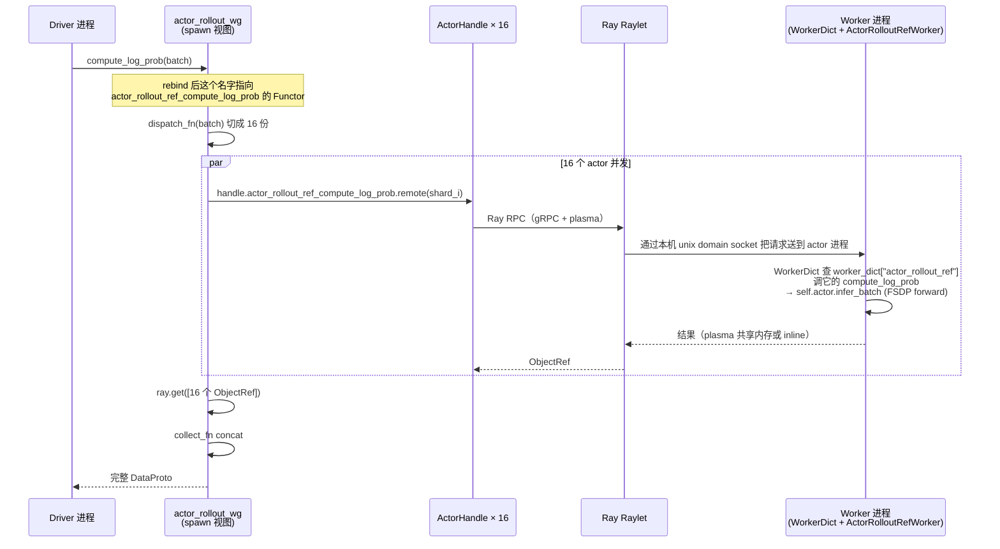

几个值得注意的点：

- **同节点**：driver / actor / raylet 之间走 unix domain socket + plasma 共享内存（不走 TCP），延迟很低
- **跨节点**：走 gRPC，对象大于 ~1MB 会进 plasma 走零拷贝
- **大张量传输**：会被 ray 自动 spill 到 plasma；这就是为什么 verl 反复在用 `DataProto.chunk` 把数据切到合适大小
- **NCCL 数据面**：`update_actor` 内部 FSDP 做 all-reduce 时**不走 Ray**，而是 actor 进程间直接通过 NCCL 通信组（在第十六章建立的那个全局 PG）做 GPU 直接传输

### 17.4 为什么 PyTorch 分布式信息走 Ray，模型梯度不走 Ray

| 通路 | 谁负责 | 为什么 |
|---|---|---|
| 控制面（方法调用、参数派发、结果收集） | **Ray RPC** | 灵活、跨语言、有 dashboard、易于调度 |
| 数据面（梯度 all-reduce / 张量并行 / 序列并行） | **NCCL**（GPU 直连） | 高吞吐、低延迟，硬件加速 |
| 进程发现（rank 0 在哪） | **Ray** 现选 master_addr | 不需要预先约定 |
| rendezvous（rank 间相互发现） | **PyTorch** init_process_group | NCCL 内部协议 |
| 权重 actor → rollout 同步 | **CheckpointEngine PG（NCCL/NIXL/Mooncake）** | 跨 worker group 的 GPU 直传，不进内存不进盘 |

**verl 把控制面交给 Ray、数据面交给 NCCL**，这种分工让"分布式编程像单机一样优雅"和"训练吞吐压满硬件"两个目标同时成立。

### 17.5 调试时常见困惑

#### Q1：driver 上 `print(self._master_addr)` 看到的 IP，到底是哪一台？

答：是 **PG_0 的 bundle 0 所在节点的 IP**。由于 `sort_placement_group_by_node_ip` 做了稳定排序，**永远是 IP 字典序最小的那台机器**。

#### Q2：单节点也有 placement group 吗？

答：有。`process_on_nodes=[8]` → 只创建 1 个 PG，含 8 个 bundle。strategy 是 `PACK`/`STRICT_PACK` 都没影响（反正只有一台机器）。

#### Q3：driver 进程是不是也是一个 actor？

答：是。`main_ppo.py:78-79`：

```python
task_runner_class = ray.remote(num_cpus=1)(TaskRunner)
runner = task_runner_class.remote()
ray.get(runner.run.remote(config))
```

`TaskRunner` 也是一个 Ray actor（`num_cpus=1`），里面调 `init_workers` / `fit`。它和 GPU worker 的区别只是它没有 GPU、没在 placement group 里、没经过 `_create_worker` 注入 RANK 等。

注释 `please make sure main_task is not scheduled on head` 暗示：作者希望 driver 不要硬绑 head 节点，让 Ray 调度器自由放置。

#### Q4：每张 GPU 上是不是只有一个进程？

答：**默认情况下是**，但可以通过 colocate 让多个 actor 共占一张 GPU（典型如 reward model 与 actor 共置）。`max_colocate_count` 控制上限。

#### Q5：`RAY_LOCAL_WORLD_SIZE`、`LOCAL_RANK` 是怎么来的？

- `RAY_LOCAL_WORLD_SIZE`：在 `_create_worker` 里注入，等于 `process_on_nodes[0]`（即每节点 worker 数）
- `LOCAL_RANK`：由 Ray 自动设置（基于 actor 在节点内的次序），或在 `Worker._setup_env_cuda_visible_devices` 里通过 `ray.get_runtime_context().get_accelerator_ids()` 兜底

### 17.6 一句话总结

> `RayWorkerGroup` 是**一个 driver 端的 Python 对象**，持有 16 个 `ActorHandle`，调度 16 个 GPU 上的独立进程；底层依靠 Ray 做空间分配 + 控制面 RPC，依靠 PyTorch + NCCL 做通信组建立 + 数据面传输；`spawn` 视图、`WorkerDict`、`ActorRolloutRefWorker` 是三层"组合 / 解耦"机制，让算法工程师在 driver 上写出"看似单机"的代码，背后却是一套精密的多层调度。

---

## 十八、异步训练（one_step_off / fully_async）完整篇

> 这一章覆盖近期梳理的全部异步训练相关问题：
> 1. 为什么要异步？同步 PPO 慢在哪？
> 2. one_step_off vs fully_async 的入口、启动方式、典型 shell
> 3. 资源拓扑：rollout 和 actor 是否共享 GPU
> 4. `PartialRollout` 是什么、怎么实现、和异步训练的关系
>
> 入口源码定位：
> - `verl/experimental/one_step_off_policy/main_ppo.py`
> - `verl/experimental/fully_async_policy/fully_async_main.py`
> - `verl/experimental/separation/utils.py`（资源池构建）
> - `verl/experimental/fully_async_policy/fully_async_rollouter.py`（PartialRollout 续推循环）

### 18.1 为什么要异步？—— 同步 PPO 的两大瓶颈

同步 PPO（`verl.trainer.main_ppo`）一个完整 step 里资源是**串行轮换**的：

```
[阶段 A]  rollout（vLLM 推理）   ── GPU 全速跑生成
[阶段 B]  log_prob / ref / RM 推理 ── 部分模块算
[阶段 C]  PPO update（actor + critic 训练） ── FSDP 训练
[阶段 D]  weight sync → 回到 A
```

由于 `hybrid_engine=True` 让 vLLM 引擎和 FSDP 训练引擎挂在**同一个 `ActorRolloutRefWorker` 进程**、共用一张 GPU，A 阶段和 C 阶段**不能同时跑**，靠 `offload / load` 在显存里切换。这带来两个瓶颈：

1. **训推阶段交替空转**：rollout 阶段 critic/ref 闲置，训练阶段 vLLM 闲置；offload + reload 本身还要消耗几秒到几十秒。
2. **长尾样本拖整 batch**：rollout 必须等最慢的那条样本跑完才能进入训练阶段。多 turn / 长 CoT 场景下，一个 batch 里 90% 样本几百 token 就停了，10% 要跑满 16k token——整 batch 等最长那条，GPU 利用率被严重稀释。

异步训练就是冲着这两个痛点去的：
- **空间换时间**：把 rollout 和 train 摆在不同 GPU 上同时跑（消除 1）
- **流水线 + 续推**：rollout 持续灌轨迹进 buffer，train 持续消费；长尾样本到 deadline 截断、下轮接着续推（消除 2）

### 18.2 同步 vs 异步的拓扑对照表

| 模式 | 入口 | rollout/actor GPU | `hybrid_engine` | 两边并行 | 容错"陈旧度" |
|---|---|---|---|---|---|
| 同步 PPO（默认） | `verl.trainer.main_ppo` | 共享同一组（colocate） | `True` | 否：rollout→offload→train→reload | 0（严格 on-policy） |
| 同步 PPO + colocate shell | `verl.trainer.main_ppo` | 共享同一组 | `True` | 否 | 0 |
| **one_step_off** | `verl.experimental.one_step_off_policy.main_ppo` | **物理分离** | **`False`** | 是（错开 1 step） | 1 step（半流水线） |
| **fully_async** | `verl.experimental.fully_async_policy.fully_async_main` | **物理分离** | **`False`** | 是（完全解耦，buffer 中转） | 由 `staleness_threshold` 控制 |

> ⚠️ 容易误读：one_step_off 提供的 `dapo_7b_math_fsdp2_colocate.sh` 实际调用的是 `verl.trainer.main_ppo`（同步入口），并非 one_step_off。这个 shell 里的 "colocate" 指同步 PPO 自身的 colocate 模式，与异步无关。

### 18.3 资源拓扑：rollout 和 actor 是否共享 GPU？

**答案：异步训练下两者物理分离，互不耦合。**

异步入口共用一段拆分逻辑：`verl/experimental/separation/utils.py:create_resource_pool_manager`。它根据 config 一次性建出**两个独立的 placement group**：

```python
# verl/experimental/separation/utils.py
trainer_pool = [config.trainer.n_gpus_per_node] * config.trainer.nnodes   # actor / critic / ref
# Role.Rollout 走另一组：config.rollout.n_gpus_per_node × config.rollout.nnodes
```

shell 里两组配置完全独立（来自 `one_step_off_policy/shell/dapo_7b_math_fsdp2_4_12.sh`）：

```bash
n_gpus_rollout=2
n_gpus_training=$((NGPUS_PER_NODE - n_gpus_rollout))   # 6

trainer.nnodes=2  trainer.n_gpus_per_node=6     # actor/critic/ref 占 12 GPU
rollout.nnodes=2  rollout.n_gpus_per_node=2     # rollout 占 4 GPU
```

`main_ppo.py` 还会把 `rollout.*` 复制到 `actor_rollout_ref.rollout.*` 让下层 worker 配置一致：

```python
# one_step_off_policy/main_ppo.py:122 / fully_async_main.py:225
config.actor_rollout_ref.rollout.nnodes = config.rollout.nnodes
config.actor_rollout_ref.rollout.n_gpus_per_node = config.rollout.n_gpus_per_node
```

最终在 Ray 视角下：**两个 placement group、bundle 完全不重叠**，actor worker 和 vLLM worker 被投到不同 GPU 上。

**为什么不能 colocate？** 异步的核心诉求是 rollout / training **同时跑满**。如果共享同一张卡：
- vLLM 通常吃 80% 显存做 KV cache，FSDP 根本放不下参数 + 优化器
- 即便能放下，两边竞争 SM，吞吐反而低于串行

所以 `hybrid_engine=False` + 两个独立 placement group 是异步训练的硬要求。

### 18.4 入口与启动方式

#### 18.4.1 one_step_off：半流水线异步

入口：`python3 -m verl.experimental.one_step_off_policy.main_ppo ...`

```python
# verl/experimental/one_step_off_policy/main_ppo.py
@ray.remote(num_cpus=10, max_concurrency=100)
class OneStepTaskRunner:
    def run(self, config):
        role_worker_mapping, ray_worker_group_cls = create_role_worker_mapping(config)
        resource_pool_manager = create_resource_pool_manager(config, role_worker_mapping.keys())
        trainer = OneStepOffRayTrainer(...)
        trainer.init_workers()
        asyncio.run(trainer.fit())   # 注意是 asyncio.run，fit 是 async 的
```

`OneStepOffRayTrainer` 继承 `SeparateRayPPOTrainer`（`verl/experimental/separation/ray_trainer.py`），核心做法：让第 N 步的训练和第 N+1 步的 rollout **同时发起**，二者 `ray.get` 时一起 await，错开一个 step 形成流水线。

典型 shell：`shell/dapo_7b_math_fsdp2_4_12.sh`（per node：4 GPU rollout + 12 GPU training，跨 N 节点）。

#### 18.4.2 fully_async：完全解耦的生产/消费

入口：`python3 -m verl.experimental.fully_async_policy.fully_async_main ...`

它把训练拆成**两个独立 Ray Actor + 一个消息队列**：

```python
# verl/experimental/fully_async_policy/fully_async_main.py
@ray.remote(num_cpus=1)
class FullyAsyncTaskRunner:
    def _initialize_components(self, config):
        self._create_trainer(config)               # FullyAsyncTrainer.remote(...)
        self._create_rollouter(config)             # FullyAsyncRollouter.remote(...)
        message_queue = MessageQueue.remote(config, max_queue_size)
        # rollouter 和 trainer 都持有 message_queue_client
        ray.get(self.components["rollouter"].set_message_queue_client.remote(...))
        ray.get(self.components["trainer"].set_message_queue_client.remote(...))

    def _run_training_loop(self):
        rollouter_future = self.components["rollouter"].fit.remote()   # 一直生产
        trainer_future   = self.components["trainer"].fit.remote()     # 一直消费
        # ray.wait(...) 监控任一方异常
```

数据流：
```
FullyAsyncRollouter (rollout GPU 组)
    │ 生成轨迹 → push → MessageQueue
    │
    ▼
[ MessageQueue (Ray Actor) ]   ← 可堆积 max_queue_size 条
    │
    │ pop → FullyAsyncTrainer (training GPU 组)
    │ 训练 → 周期性 push 新 weights → Rollouter
    ▼
loop forever
```

参数同步靠 `async_training.trigger_parameter_sync_step`（每训练 N 步同步一次权重），陈旧度靠 `async_training.staleness_threshold` 控制（旧轨迹被丢弃或降权）。

典型 shell：`shell/dapo_7b_async_retool.sh`（4 GPU rollout + 4 GPU training，配 multi-turn tool calling）。

#### 18.4.3 两者关键区别

| 维度 | one_step_off | fully_async |
|---|---|---|
| Driver 拓扑 | 一个 Trainer Actor 同时管两边 | Rollouter Actor + Trainer Actor 平级 |
| 中转介质 | 直接 RPC | `MessageQueue` Ray Actor |
| 错峰幅度 | 严格 1 step | 可堆积 N 个 step（取决 queue 大小）|
| weight sync 时机 | 每步固定 | `trigger_parameter_sync_step` 触发 |
| 适合场景 | rollout 和 train 时长接近 | rollout 显著长于 train（multi-turn / tool） |

### 18.5 PartialRollout：长尾样本的续推机制

#### 18.5.1 它解决什么问题

异步训练给你了"rollout/train 同时跑"，但**长尾样本**仍然是麻烦：rollout 一个 step 想生产 N 条轨迹，但其中几条要跑 16k token，剩余的几百 token 就完事——这几条长样本会**长时间占着 KV cache 槽位**，让 batch throughput 卡住。

**PartialRollout 思路**：到 deadline（一般是 weight 已经更新到下一版本）就把没生成完的样本中止，**保留已生成 tokens**，下一轮带着这些 tokens 当 prefix **接着续推**，而不是从头重跑。

#### 18.5.2 触发开关

```bash
async_training.partial_rollout=True
```

只在 fully_async 入口生效（`one_step_off` 没这个 deadline 概念）。

#### 18.5.3 实现核心：`fully_async_rollouter.py` 的续推循环

```python
# verl/experimental/fully_async_policy/fully_async_rollouter.py:90-150（精简）
final_output = ...            # 累积器：token_ids / log_probs / routed_experts
while True:
    # 1. 用 prompt + 已经累积的 token_ids 继续 generate
    output = await super().generate(
        request_id=request_id,
        prompt_ids=prompt_ids + final_output.token_ids,   # 关键：把已生成 token 当 prefix
        sampling_params=sampling_params,
        ...
    )

    # 2. 把这次新增的 token 拼到累积器上
    final_output.token_ids.extend(output.token_ids)
    if output.log_probs is not None:
        final_output.log_probs.extend(output.log_probs)
    final_output.stop_reason = output.stop_reason

    # 3. 更新剩余可生成 token 数（防超 max_response_length）
    if original_max_tokens is not None:
        sampling_params[limit_key] = original_max_tokens - len(final_output.token_ids)
        if len(final_output.token_ids) >= original_max_tokens:
            final_output.stop_reason = "length"
            break

    # 4. 关键判断：如果是被 abort 而且开了 partial_rollout，就继续续推；
    #    其他正常 stop_reason（length / eos / stop_token）则跳出。
    if output.stop_reason not in ("aborted", "abort") or not self.config.async_training.partial_rollout:
        break
    await asyncio.sleep(1)

# 把当前模型版本号也带在 output 里，下游可据此判断 staleness
final_output.extra_fields["global_steps"]     = global_steps
final_output.extra_fields["min_global_steps"] = min_global_steps   # 期间最早的版本
final_output.extra_fields["max_global_steps"] = max_global_steps   # 期间最新的版本
```

要点：
1. **续推 = prefix 拼接重发**：`prompt_ids + final_output.token_ids` 当作新 prompt 喂给 vLLM；vLLM v1 的 prefix cache 会自动复用前缀的 KV，**不会真的从 token 0 重算**。
2. **abort 是触发条件**：当 weight sync 发生时，rollouter 会 abort 在飞请求（让显存腾给新参数），样本以 `stop_reason="aborted"` 返回——此时进 while 循环再发一次。
3. **跨版本采样**：续推前后可能跨越多个 weight 版本，所以记录 `min_global_steps / max_global_steps`，下游 trainer 据此决定是否丢弃或纠偏（重要性采样）。
4. **`final_output.routed_experts` 的拼接逻辑**：MoE 路由信息每次只追加新生成 tokens 对应的部分，避免重复。

测试样例参考 `tests/workers/rollout/rollout_trtllm/test_trtllm_abort.py`：

```python
# 模拟 partial rollout 的最小用例
continued_prompt_ids = list(all_prompt_ids[i]) + list(partial_output.token_ids)
ref = server.generate.remote(
    prompt_ids=continued_prompt_ids,
    sampling_params=sampling_params,
    request_id=f"partial_rollout_{i}_{uuid4().hex[:8]}",
    ...
)
```

#### 18.5.4 PartialRollout 与异步训练的关系

- **正交但互补**：PartialRollout 解决"长尾样本浪费"，资源分离解决"训推不能同时"，两者解决不同问题。
- **必须同时具备 abort 能力**：PartialRollout 依赖 vLLM/SGLang/TRT-LLM 的 `abort` API + prefix cache，所以只有这些后端 + async mode 下才生效。
- **同步训练用不上**：同步训练里 rollout 一停就要等 train，没有"deadline 中断"的概念，PartialRollout 没意义。

### 18.6 一句话总结

> **同步 PPO**：rollout 和 actor 共享同一组 GPU，时间维度上轮流用，长尾样本拖垮 batch。
> **one_step_off**：rollout 和 actor 各占一组 GPU，错开 1 step 形成简单流水线。
> **fully_async**：rollout 和 actor 各占一组 GPU + 一个 MessageQueue 当 buffer，完全解耦的生产/消费，配 `staleness_threshold` 控制 off-policyness，配 `PartialRollout` 解决长尾样本。
> 异步的本质是"用 GPU 数量 + 容忍 off-policy 换吞吐"——多一组 GPU、放弃严格 on-policy，换来 rollout/train 全程跑满 + 长尾样本不再阻塞。

---


